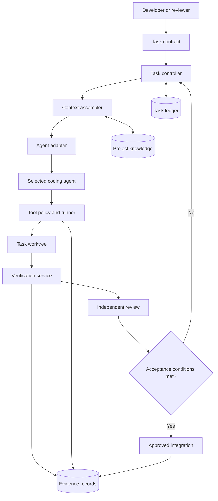
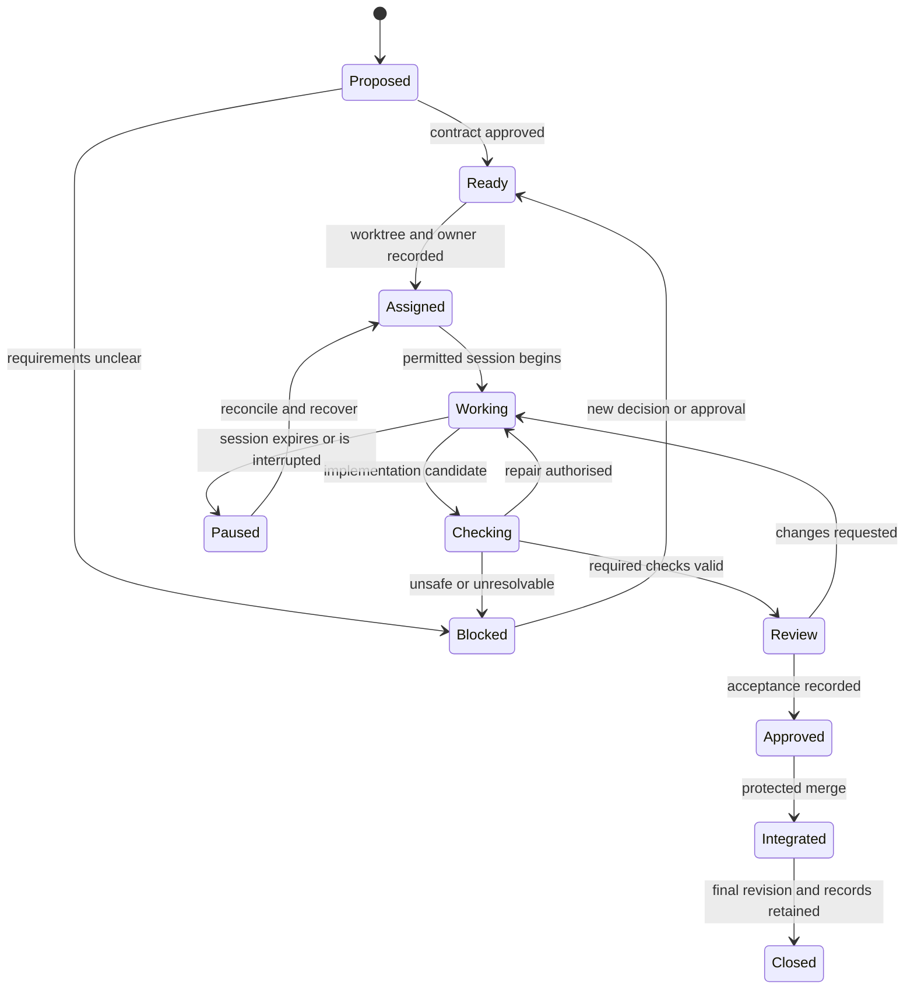
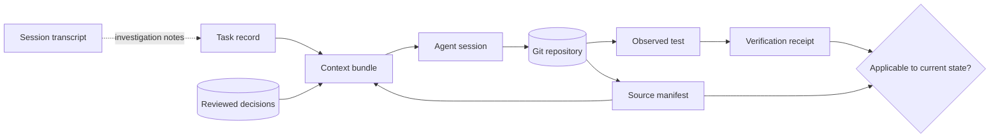
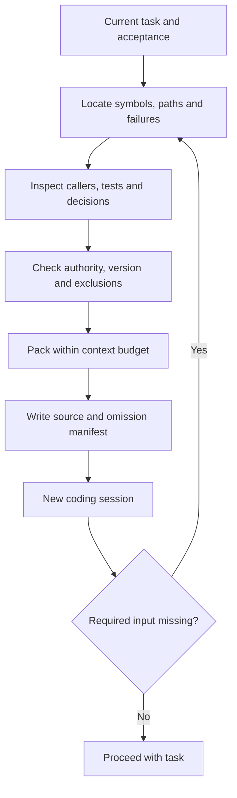
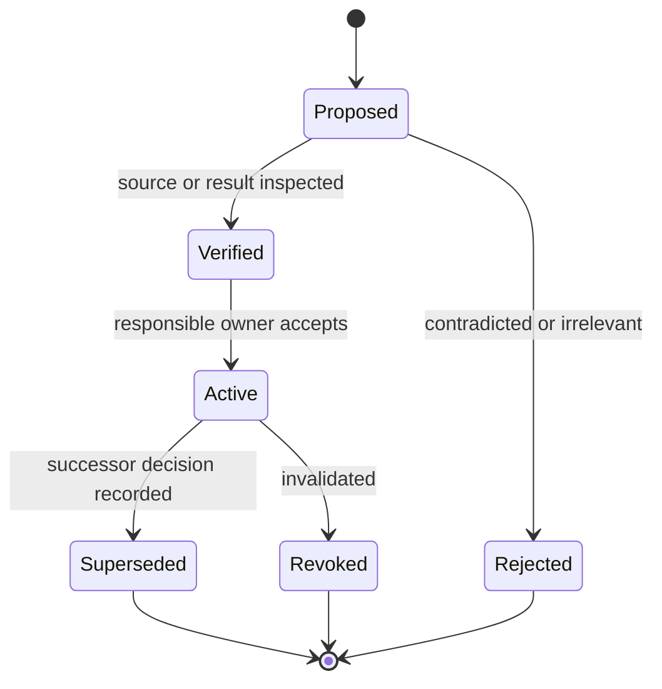
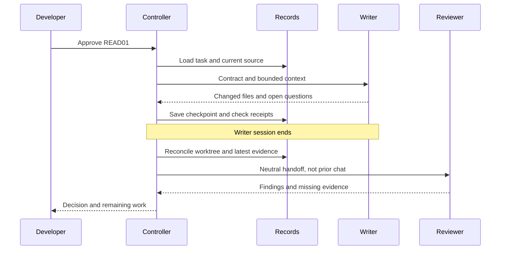
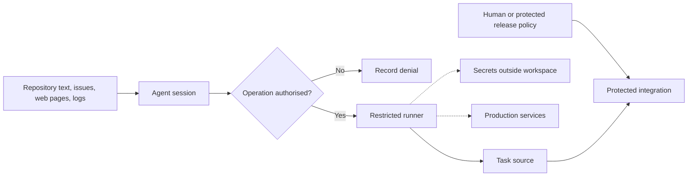
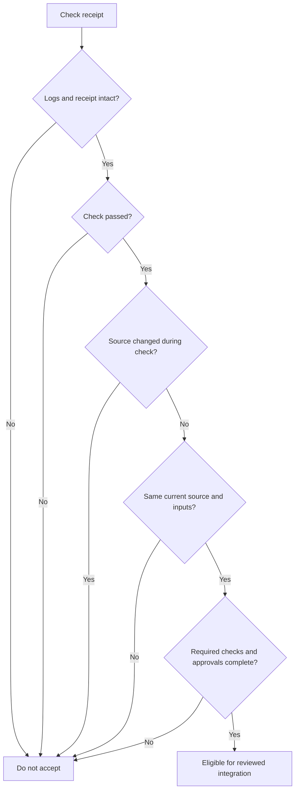

# Context to Commit: System Architecture

The purpose of this architecture is to let a developer finish a change without depending on the conversation that produced it. A task can pass from one coding agent to another, an interrupted session can be reconstructed, and a claimed result can be checked against the files that were actually tested.

This document specifies the system behind [MASTERPLAN.md](MASTERPLAN.md). It describes the full design as well as the smaller local implementation in that document. They should not be mistaken for the same thing.

## 1. Architectural position

A coding agent is an operator inside an engineering process. It can inspect, reason, edit and suggest. It cannot be the sole authority for permissions, task completion, test results or release decisions. The surrounding software and the responsible developer must be able to answer four questions independently:

1. What work was authorised?
2. Which source and project facts were available when it ran?
3. What changed, and what checks were observed?
4. Can the task be resumed without the original agent session?

The simplest useful design is a task record, a Git worktree, a small context package, one coding agent and a repeatable check. Everything else should be justified by a failure that the simpler arrangement cannot handle.

### Design maturity

| Area | In the local `harness.py` from `MASTERPLAN.md` | Required for a deployed system |
|---|---|---|
| Task creation | Local JSON record and a Git worktree | Transactional creation, recovery and ownership leases |
| Context | Explicit file list, size limits, source digests, omission notices | Dependency retrieval, policy based access, freshness checks |
| Memory | Source linked proposed observation | Reviewed decisions, conflict handling, retention and durable storage |
| Verification | Fixed `unittest` command, logs, digest and audit exit code | Isolated runner, immutable artifacts, environment capture and CI policy |
| Session recovery | Neutral Markdown handoff | Durable checkpoint protocol and automatic reconciliation |
| Agent integration | Manual invocation in the worktree | Tested adapters and normalised events with cancellation |
| Permissions | Limited path checks inside the context reader | Operating system isolation, scoped credentials and approval service |
| Coordination | One local operator | Concurrent task ownership, queues, retries and conflict control |

An explicit limitation is preferable to a feature described as working when it is only designed.

## 2. System boundaries



**Reading the diagram:** requirements enter through a task contract. The controller selects context and an agent. The agent uses permitted tools against a task worktree. Verification and review examine the result. The acceptance gate is outside the agent's control. Task, knowledge and evidence stores allow a new session to reconstruct the work.

There are three distinct boundaries:

- **Authority:** human approval and enforced policy sit outside the instructions an agent can edit.
- **Execution:** a worktree separates Git changes; a sandbox or restricted machine separates process privileges. One does not replace the other.
- **Evidence:** the writer may submit code, but must not be able to rewrite trusted verification records or approve its own production release.

## 3. Responsibilities and interfaces

| Component | Inputs | Outputs | Failure behaviour |
|---|---|---|---|
| Task controller | Scope, base revision, acceptance criteria, risk | Task ID, state, ownership and budget | Reject incomplete or conflicting task |
| Worktree manager | Repository, base commit, task ID | Task branch and inspected checkout | Preserve partial creation for reconciliation |
| Context assembler | Task, source revision, approved paths, budget | Versioned context bundle and omissions | Mark missing required input; never silently trim it |
| Knowledge register | Reviewed project facts, decisions, provenance | Current decisions with source pointers | Report conflict, expiry or supersession |
| Agent adapter | Neutral invocation and permitted capabilities | Structured events, outcome and artifacts | Separate provider failure from task failure |
| Restricted runner | Command array, execution policy, workspace | Process status, logs and environment record | Deny unauthorised action; stop at resource limit |
| Source manifest service | Worktree snapshot and defined input set | Content digest and coverage statement | Return indeterminate if snapshot is unstable |
| Verifier | Source identity, check plan, isolated environment | Result and source bound receipt | Preserve failure independently of source changes |
| Review gate | Contract, diff, receipts, risk classification | Findings and decision | Block missing evidence or unresolved high risk findings |
| Evidence store | Logs, receipts, signatures if configured | Immutable or protected references | Reject missing, modified or unauthorised records |

Each component has a deliberately narrow contract. The controller does not need to understand how a provider tokens its input. The verification service does not accept an agent's written assurance that a test succeeded. The memory store does not decide which production permissions a task receives.

## 4. A task has one identity and a defined lifecycle

A task ID identifies the work, not the conversation, branch name or model. A branch can be recreated; an agent can change; the task identity remains.



A controller may implement fewer states initially, but the underlying distinctions matter. `Checking` is not `Approved`. `Approved` is not `Integrated`. A crashed agent is not an abandoned task.

### Transition conditions

| Transition | Minimum evidence |
|---|---|
| Proposed to Ready | Outcome, exclusions, tests and approval owner |
| Ready to Assigned | Recorded base commit, worktree path and writer |
| Assigned to Working | Context manifest and effective permissions |
| Working to Checking | Candidate revision and test request |
| Checking to Review | Required checks passed against the current source identity |
| Review to Approved | Resolved findings and recorded authority |
| Approved to Integrated | Branch protection or equivalent protected operation |
| Paused to Assigned | Reconciled Git state and handoff evidence |

State transitions should be validated in storage, not inferred from a chat transcript. A later distributed implementation needs optimistic versioning or transactional compare and swap. Two controllers must not both believe they own the same write lease.

## 5. Source, conversation and evidence are different records



A conversation is useful evidence of what someone considered, but it can contain guesses, obsolete facts and incomplete tool output. Git establishes the committed history; the worktree holds current edits. A verification receipt states what a specific check observed. The receipt remains historically true even after another edit makes it inapplicable.

The local reference computes a digest over Git tracked and nonignored untracked files, plus file modes and symlink targets. It deliberately excludes ignored files. This is adequate for demonstrating invalidation after ordinary edits; it is not a complete declaration of build inputs. A stronger system must capture dependency lock files, container image digests, relevant generated inputs, environment identifiers and external fixtures as part of the claim.

### Source state and verification status

Record at least these values independently:

```json
{
  "task_id": "READ01",
  "source_state": {
    "base_commit": "<actual-git-commit>",
    "worktree_digest": "<calculated-sha256>",
    "coverage": "git tracked and nonignored untracked files"
  },
  "verification": {
    "process_exit_code": 1,
    "test_outcome": "failed",
    "workspace_mutated_during_check": true,
    "receipt_integrity": "valid",
    "applicable_to_current_state": false
  }
}
```

These values must not be collapsed into a single `stale` or `success` flag. A test can fail and modify source files during the same run. A test can pass and later become stale. A receipt may be intact but reflect an environment that is no longer acceptable.

## 6. Storage and retention

Choose storage according to its purpose, not according to whichever file an agent already understands.

```text
repository/
    MASTERPLAN.md
    ARCHITECTURE.md
    IMPLEMENTATION.md
    TESTING.md
    docs/
        decisions/                 reviewed and committed decisions
        project/                   architecture facts and interfaces

local checkout, excluded from Git:
    .worklog/
        tasks/                     local task records
        context/                   generated context bundles
        checks/                    output logs and receipts
        handoffs/                  session transfer notes
        proposed_memories.jsonl    unreviewed observations

outside the task writer's reach, when deployed:
    task database                 leases and state transitions
    protected artifact store      signed or access controlled evidence
    approval records              authenticated decisions
    backup and retention service  recovery across machines
```

The local reference uses `.worklog/`; it is ignored by Git. **Ignored does not mean durable.** A laptop failure can destroy those records. A decision that must remain part of the project should be reviewed and committed to `docs/decisions/`. Execution logs and sensitive handoffs belong in a protected artifact store with an explicit retention period, not in a public repository.

Avoid saving credentials, raw customer information or unnecessary chat transcripts into any general memory index. If a model provider or tool service stores additional telemetry, its retention must be considered separately.

### A minimal record contract

The production design can begin with these logical entities:

| Entity | Important fields | Constraint |
|---|---|---|
| `Task` | `id`, `goal`, `base_commit`, `acceptance`, `risk`, `state`, `version` | Unique ID; validated state transition |
| `Lease` | `task_id`, `owner`, `expires_at`, `generation` | One active writer per task workspace |
| `ContextBundle` | `id`, `task_id`, `source_digest`, `items`, `omissions`, `budget` | Sources attributable and required items present |
| `Decision` | `id`, `statement`, `reason`, `source`, `status`, `supersedes` | Active decision cannot contradict unresolved active policy |
| `Invocation` | `id`, `task_id`, `adapter`, `capabilities`, `started`, `ended` | Provider completion separate from acceptance |
| `CheckReceipt` | `id`, `source_digest`, `command`, `environment`, `exit_code`, `mutation`, `artifacts` | Logs referenced by digest; immutable after issue |
| `Approval` | `id`, `task_id`, `scope`, `approver`, `expiry`, `decision` | Cannot be authored by untrusted tool output |
| `Event` | `id`, `task_id`, `actor`, `type`, `time`, `previous_version` | Append only for material transitions |

Do not treat the example fields as an official standard. The project must version its own schemas and define migration rules before different implementations write to the same store.

## 7. Context assembly

Context control is a retrieval problem with authority constraints. A file is not important merely because it was recently mentioned. A higher priority requirement might be an older architecture decision that directly governs the current change.



### Required bundle contents

A context package carries the task contract, source revision, selected excerpts and their hashes, active decisions, relevant test failures, excluded material and explicit omissions. Keep instructions and retrieved data separate. File contents and web pages can provide facts but cannot expand the agent's privileges.

A budget should reserve room for tool results, diagnosis and a handoff. For an illustrative budget `W`:

```text
usable context = W - platform overhead - expected tool output - response reserve - headroom
```

No fixed percentage is safe for every provider or task. Use actual telemetry where available. A missing required schema cannot be replaced by more unrelated code. If mandatory context exceeds the budget, split the task or ask for a narrower operation.

### Omission policy

An assembler must distinguish `not found`, `not permitted`, `too large`, `binary`, `superseded` and `not retrieved`. Those are different conditions with different next actions. The local implementation only handles a subset. It reports file truncation and total byte budget omissions; semantic relevance and policy classification remain manual.

## 8. Memory and decision authority

Project knowledge is not a transcript summary. It is a set of attributable statements with update rules.



A useful memory record identifies the statement, scope, author or admitting service, source path and revision, decision status, and any successor. The confidence of a model's prose is not an admission criterion.

**Example:** an old note says the project uses SQLite; the current configuration and approved migration decision say PostgreSQL. Retrieval must show the conflict and favour the active, evidenced decision. It must not return both as equally binding instructions.

Some observations should never become durable memory. Terminal noise, one time guesses and copied secrets increase risk without improving continuity. Save them only in task artifacts when they are genuinely useful and permitted.

## 9. Session renewal and cross agent continuity



A handoff should contain enough to reconstruct work, not an imitation of the previous agent's private reasoning. It identifies current code, active task, accepted design, actual tests, unresolved risks, relevant sources and the next permitted action.

Renew on milestones, context pressure, repeated failures, provider changes or long inactivity. A fresh session must compare the handoff with Git before editing. If the worktree has changed, rerun affected checks and rebuild context.

## 10. Provider adapters

Claude Code, Codex, Gemini CLI and OpenCode differ in invocation, output events, project instructions, authentication and execution controls. The adapter presents a common task to the controller but does not erase those differences.

The proposed invocation contract is:

```json
{
  "schema_version": 1,
  "task_id": "READ01",
  "role": "reviewer",
  "provider": "chosen_by_policy",
  "cwd": "<absolute-task-worktree>",
  "context_file": "<verified-bundle-path>",
  "capabilities": ["read", "report"],
  "timeout_seconds": 300,
  "artifact_dir": "<protected-output-path>"
}
```

An adapter must validate the request; identify the installed provider and version; establish the correct directory; apply actual restrictions; capture process exit, output and tool observations; support cancellation where available; and return a provider independent result. The controller must not equate `process_exit_code: 0` with a verified software change.

### Two protocols, different boundaries

| Interface | Responsibility | What it does not establish |
|---|---|---|
| Model Context Protocol (MCP) | Connecting hosts to external tools and data | Approved access to every connected resource |
| Agent Client Protocol (ACP) | Connecting applications to compatible coding agents | Identical persistence, permissions or outcomes across vendors |
| Provider CLI or SDK | Invoking the chosen agent | An application wide task ledger or trusted verification process |

The first integration can use subprocess commands under a controlled supervisor. ACP or native SDKs are worth evaluating when their lifecycle features and semantics are needed. Never pass an arbitrary model generated command string to a privileged shell.

### Ownership of parallel work

One active writer per task worktree is the default. Research and review may proceed concurrently with read access. Multiple writers need separate worktrees, defined interfaces and an integration owner. Nonoverlapping files do not guarantee nonconflicting behaviour; two agents can independently change a schema and its callers in incompatible ways.

## 11. Execution and security



The dotted connections indicate resources that should not be implicitly reachable. A prompt telling an agent not to inspect secrets is not sufficient if the process can read them. Likewise, `git worktree` cannot prevent the program inside it from accessing the user's home directory or network.

### Minimum risk controls

| Risk | Enforced measure |
|---|---|
| Untrusted issue asks for credentials | Tool policy refuses undeclared file and network access |
| Agent attempts production migration | Separate approval and scoped production identity |
| Test invokes malicious build script | Container, restricted account or remote sandbox without developer secrets |
| Agent modifies CI to weaken checks | Protected review of workflow and dependency changes |
| Retry duplicates an external action | Idempotency key or explicit outcome reconciliation |
| Agent declares its own check valid | Independent checker verifies receipt and current source |
| Context file contains private information | Deny access before reading; redact at capture when appropriate |

The local reference does not implement these operating system controls. Its fixed `unittest` invocation still executes repository code with the invoking user's permissions. Do not run it against a repository you do not trust.

## 12. Verification and acceptance

Three separate facts are required for an acceptable result:

1. The required check executed and passed.
2. The check's receipt is intact and applies to the current source and relevant environment.
3. The scope, review findings and necessary approvals are satisfied.



A passed check is a bounded observation, not a guarantee that software has no defects. The production checker should record environment inputs, exact command and artifacts. For consequential changes, it should execute in a controlled environment and store receipts where the coding agent cannot alter them.

The local `audit` command validates a narrower claim: the latest recorded Python unittest result passed, the check did not modify Git visible source, its stdout and stderr still match the stored digests, and the current manifest matches the checked manifest. It returns a nonzero exit status for failure. It does not authenticate the author of the receipt or prove that ignored inputs were unchanged.

## 13. Failure handling

| Failure | Evidence to keep | Recovery |
|---|---|---|
| Agent session interrupted | Task, worktree state, last receipts, unresolved steps | Open a new session with reconciled handoff |
| Crash after worktree creation | `git worktree list`, branch name, partial local record | Inspect and repair; never delete unknown work blindly |
| Context missing key schema | Omission manifest and affected test | Retrieve exact source or narrow the task |
| Previous check now stale | Old receipt and new source digest | Run the required check again |
| Test fails and mutates files | Failed exit status and both manifests | Preserve failure, inspect mutations, rerun after repair |
| Tampered log | Expected and observed digest mismatch | Reject receipt and investigate control boundary |
| Two writers claim ownership | Lease versions and event history | Stop conflicting writes and reconcile branches |
| External write times out | Request ID, idempotency key and remote status | Reconcile outcome before retrying |
| Suspected credential exposure | Access logs and affected identities | Stop access, rotate or revoke and investigate |

For automated repair, define a retry budget and a stop condition before execution. Three attempts repeating the same failure without new evidence are not three useful engineering iterations.

## 14. Operating profiles

### Profile A: one developer

Use Git, a written task, isolated worktree, relevant tests and a handoff. Store accepted decisions in tracked documents. The local reference is appropriate only for a trusted learning repository. Do not introduce a database or coordinator until the work requires it.

### Profile B: small team

Add protected pull requests, clear ownership, a shared decision register, continuous integration and a review policy. Record task outcomes in existing issue tracking where possible. Preserve execution evidence with an agreed retention policy.

### Profile C: concurrent or sensitive work

Add transactional task storage, work leases, sandboxed execution, identity and approval services, protected artifact storage, audit logging, reproducible build environments and recovery drills. Treat any change to permissions, dependency installation, infrastructure or production data as a separate authority decision.

Complexity should be purchased by measured risk reduction, not by the number of available models.

## 15. Architecture decisions to keep explicit

| Decision | Chosen direction | Reason | Reconsider when |
|---|---|---|---|
| D01 | Task is the durable unit of work | Chat sessions expire and vary by provider | Never without a replacement continuity method |
| D02 | Git owns source history | Proven diff, review and merge workflow | Repository ceases to be Git based |
| D03 | One writer per worktree by default | Prevents uncontrolled file collisions | Lease based coordination is tested |
| D04 | Context is assembled per task | Reduces stale and unrelated input | Retrieval tests justify another policy |
| D05 | Reviewed decisions live with the project | Local runtime records can disappear | A protected authoritative knowledge service exists |
| D06 | Checks are independent of agent prose | Claims must be reproducible | Never for consequential changes |
| D07 | External writes need explicit capabilities | Text must not grant authority | A formally reviewed equivalent exists |
| D08 | Source identity includes a coverage statement | Hashing only part of the build is not full provenance | Complete input attestation becomes available |
| D09 | Adapters are replaceable | Avoids coupling task state to provider sessions | One provider becomes an explicit platform requirement |
| D10 | Start with local commands, graduate with evidence | Simpler behaviour can be inspected and taught | Multiuser requirements or risk demand more |

Record substantive deviations as a reviewed decision in the repository. An old design note should be marked superseded rather than left beside its replacement as though both remain active.

## 16. Architecture acceptance review

Before implementing more than the local reference, the responsible developer should be able to demonstrate the following:

- A named task with a known base revision and verifiable acceptance criteria.
- A worktree that contains changes belonging to one writer.
- A context bundle whose sources, omissions and current revision can be inspected.
- A handoff that can be read without the outgoing session.
- A failed test remaining marked as failed even when it modifies source.
- A passing receipt becoming inapplicable after a source edit.
- A denied operation staying denied even when a repository file asks for it.
- A reviewed integration decision separate from the implementer's last message.
- A candid record of what was not checked.

Use [IMPLEMENTATION.md](IMPLEMENTATION.md) to build these behaviours in order. Use [TESTING.md](TESTING.md) for repeatable acceptance exercises and the failure matrix. The main learning sequence and full local reference code remain in [MASTERPLAN.md](MASTERPLAN.md).

## References

The design relies on the documented behavior of Git worktrees, Python's subprocess and unittest facilities, the four coding agent interfaces, and established security guidance. These are technical sources, not endorsements of the proposed architecture.

- [Git, worktree manual](https://git-scm.com/docs/git-worktree)
- [Python, subprocess](https://docs.python.org/3/library/subprocess.html)
- [Python, unittest](https://docs.python.org/3/library/unittest.html)
- [Anthropic, Claude Code project memory](https://code.claude.com/docs/en/memory)
- [OpenAI, Codex instructions](https://developers.openai.com/codex/guides/agents-md)
- [Google, Gemini CLI headless mode](https://github.com/google-gemini/gemini-cli/blob/main/docs/cli/headless.md)
- [OpenCode, CLI](https://opencode.ai/docs/cli/)
- [Model Context Protocol](https://modelcontextprotocol.io/)
- [Agent Client Protocol](https://agentclientprotocol.com/get-started/introduction)
- [OWASP, security risks in language model applications](https://owasp.org/projects/top-10-for-large-language-model-applications/)
- [GitHub, secure use of Actions](https://docs.github.com/en/actions/reference/security/secure-use)
