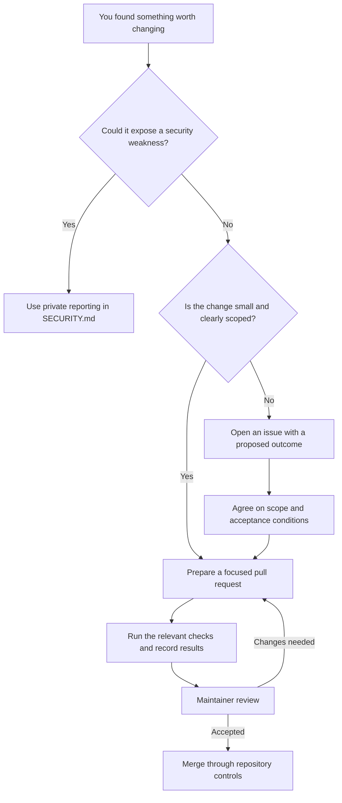

# Contributing to Context to Commit

Context to Commit is a practical engineering project about developing software with coding agents while keeping the work inspectable. A useful contribution makes a claim more accurate, a procedure easier to reproduce, a boundary harder to cross, or a failure easier to understand.

You do not need experience building agent infrastructure to contribute. A broken command found while following the reading queue exercise can be more valuable than a large new feature. Show what happened, what you expected, and which revision you used. That gives someone else a way to confirm the problem.

Please read [SECURITY.md](SECURITY.md) before publishing a report about access controls, credentials, path restrictions, or evidence tampering. Findings that expose a security weakness belong in a private report, not a public issue with exploit instructions.

## 1. What belongs in this repository

The main document is [MASTERPLAN.md](MASTERPLAN.md). It explains the engineering approach and includes the small reference program. The supporting files have separate jobs:

| File | What a contribution should improve |
|---|---|
| [MASTERPLAN.md](MASTERPLAN.md) | The technical argument, progressive exercises, explanations and code listing |
| [ARCHITECTURE.md](ARCHITECTURE.md) | Component boundaries, state transitions, interfaces and design decisions |
| [IMPLEMENTATION.md](IMPLEMENTATION.md) | Setup commands and procedures a developer can actually run |
| [TESTING.md](TESTING.md) | Checks, expected failures, reproducible experiments and evidence requirements |
| [SECURITY.md](SECURITY.md) | Threat model, disclosure process, permission boundaries and safety controls |
| [RESEARCH.md](RESEARCH.md) | Sources, distinctions between claims, limitations and open experiments |
| [ROADMAP.md](ROADMAP.md) | Work that remains, dependencies, ownership and acceptance gates |
| [CHANGELOG.md](CHANGELOG.md) | Reader visible changes that have actually been made |

Avoid adding a second explanation of an existing subject simply because a new page would be easier to write. Improve the authoritative section and link to it. If a new section cannot be placed cleanly, explain the reason in the issue or pull request.

Contributions we can review include corrections to technical details, accessibility improvements, reproducibility fixes, new failure cases, security tests, carefully bounded provider adapters, and research that changes an engineering decision. Benchmark results are useful only when the test set, configuration, costs, and unsuccessful runs can be examined.

## 2. Choose the right route



### A documentation correction

A spelling error, dead link, ambiguous sentence or incorrect command can usually go straight to a small pull request. Give the section name and explain the correction. If a command changes, confirm the exact replacement in the environment described by the instructions.

### A new implementation capability

Start with an issue when the proposal changes a task schema, state transition, provider interface, evidence record, security policy, or dependencies. The issue should describe the failure the capability addresses, the smallest acceptable solution, alternatives considered, and how it would be tested. Link it to the relevant item in [ROADMAP.md](ROADMAP.md), or explain why the roadmap should change.

### A research correction

Quote the specific claim or identify its section, then link to a primary source. State exactly what the source establishes and whether it applies to the version or context under discussion. A new vendor feature is not evidence that an older comparison was universally wrong. Published studies should retain their methods and limitations when summarized.

### A security finding

Use the reporting procedure in [SECURITY.md](SECURITY.md). Do not post credentials, hostile payloads that work against real targets, private logs, or live exploit steps in a public discussion. Use synthetic values and systems you own for reproduction.

## 3. Before you open an issue

Search existing issues and the documents linked above. Some gaps are intentional. For example, the reference harness runs tests as the current user, does not create an operating system sandbox, and does not provide live adapters for every named coding agent. Those limits are described in the masterplan and security policy. A useful improvement proposal should identify the additional boundary it would enforce, not simply state that the current sample lacks it.

A good issue describes the observation with enough detail that another person can act on it:

```markdown
### What I tried
Ran the reading queue exercise from a clean checkout.

### Expected behavior
The audit should exit unsuccessfully after the checked source changes.

### Actual behavior
The command returned status 0 after changing a covered file.

### Reproduction
1. Commit or record the starting revision.
2. Run the documented verification command.
3. Edit the identified source file.
4. Run the audit command and record its exit status.

### Environment
Git revision:
Python and Git versions:
Operating system:
Relevant agent or tool version, if used:

### Evidence
Commands, output excerpts, test results and sanitized logs.

### Proposed correction
Describe a testable result rather than a preferred implementation alone.
```

This is an example of issue structure, not a statement that the current audit has this defect. The reference program is intended to reject a changed covered file. If your result contradicts that, it is worth investigating.

For a proposal rather than a bug, replace the reproduction with a short design note: observed limitation, expected benefit, alternative approaches, security implications, and a way to know whether the change helped.

## 4. Prepare a working branch

Use a fork or a branch that you have permission to push. Start from a current revision and keep the patch focused. The examples below assume the default branch is `main`; verify it before running Git commands.

```bash
git clone <repository-url>
cd <repository-directory>
git status --short
git switch main
git pull --ff-only
git switch -c docs/clarify-context-budget
```

Use a branch name that identifies the work, such as `docs/fix-example-command`, `test/evidence-tamper`, `fix/audit-status`, or `feature/provider-adapter`. These are conventions for clarity, not mandatory naming rules.

Do not run destructive cleanup commands to force a clean checkout. If a local workspace contains uncommitted work, inspect it, preserve it, or create a separate worktree. A contributor's data is not disposable merely because a command fails.

### Code and example layout

The reference `harness.py` is printed in `MASTERPLAN.md`. [IMPLEMENTATION.md](IMPLEMENTATION.md) shows how to extract that exact listing into a disposable reading queue repository. Until the maintainers formally choose and enforce a different canonical source, treat the published listing as authoritative. An updated runnable example must have a matching published listing, or an explicit decision and parity check that prevents them from diverging.

The reading queue exercise creates its own Git repository and temporary worktrees. Do not commit generated `.worklog/` records, nested `.git` directories, credentials, caches, machine specific outputs, or live session exports into the publication repository. A test should use temporary directories and disposable data when possible.

## 5. Demonstrate the result

A good change gives the reviewer enough information to confirm the same outcome. Match your checks to the change rather than attaching an impressive but unrelated list of commands.

| Change | Minimum evidence |
|---|---|
| Typo or wording | The affected location, clear replacement, and no broken Markdown links |
| Code fence or setup command | Actual command run and observed output in a clean working environment |
| Reference program change | Relevant automated tests, failure case before the fix when appropriate, and passing checks afterward |
| Source manifest or audit change | Test for stale, missing, failed, altered and applicable evidence as relevant |
| Context retrieval or memory rule | Source attribution, omitted or superseded record cases, and a negative test |
| Provider adapter | Identified provider version, invocation artifacts, cancellation/error behavior and enforced permissions |
| Security control | Denied operation observed in the restricted environment, plus no regression in allowed operations |
| Performance or cost claim | Task set, versions, baseline, costs, failed attempts, sample size and uncertainty |

The detailed reference test procedure is in [TESTING.md](TESTING.md). For the local code the first commands are typically:

```bash
python3 --version
git --version
python3 -m py_compile examples/reading-queue/harness.py
python3 -m unittest discover -s tests -p 'test_reference_harness.py' -v
git diff --check
```

The example file paths above exist only after the setup described in [IMPLEMENTATION.md](IMPLEMENTATION.md) has been carried out. If the repository has not yet committed runnable copies of the tests, follow that setup first. Do not report a command as passed if it was not executed or if it was run against a different revision.

**A failing test may be the intended first result.** The reading queue begins with a deliberately defective completion operation. Record that failing baseline, then show that the actual repair makes the relevant test pass. Never rewrite a test solely to make a broken implementation look successful.

If you could not run a check, state why. A useful honest limitation is preferable to a fabricated green result.

## 6. Documentation and research standards

The writing should sound like a developer explaining something to another developer. Prefer precise statements to broad promises. A sentence such as “the receipt records the test exit code and a file digest” is testable. “The system ensures complete reliability” is not.

When editing technical material:

- Check the actual command, file name, interface and version before explaining them.
- Use normal headings and short paragraphs. Tables are useful for differences, not as a substitute for reasoning.
- Keep Mermaid diagrams editable in Markdown. Provide an adjacent explanation for someone reading raw text or using an interface that does not render diagrams.
- Do not paste substantial copyrighted material from a source. Summarize it in your own terms and include a direct reference.
- Distinguish **official documentation**, **published research**, **locally observed results**, and **proposed design**. Do not quietly promote a recommendation into a measured finding.
- Preserve negative results and known limits. A corrected error should remain traceable in the changelog if readers may have relied on the old instructions.
- Check that paths, section links, examples, and citations still resolve after moving material.

The research register in [RESEARCH.md](RESEARCH.md) gives the expected evidence categories and citation treatment. When an official provider interface changes, update the affected guidance and note the supported or tested version. Do not guess at default permissions or model behavior from a product name alone.

### Coding agents used during contribution

You may use coding agents to investigate, draft, or test a patch. You remain responsible for what you submit. Inspect every changed file, verify commands independently, and make sure generated output has not inserted secrets, imaginary citations, unsafe actions, or changes outside the agreed scope.

An agent's sentence saying “all tests pass” is not a test receipt. When automation made or checked a consequential change, the pull request should link the observed command or CI result and identify what could not be verified. No contributor should feel pressure to claim they worked without tools; what matters to review is the source, reasoning, and reproducible evidence.

Do not add assistant transcripts, private prompts, provider logs, hidden instructions, or unlicensed generated media to the repository. An excerpt may be attached only when it is necessary, sanitized, and relevant to diagnosing a problem.

## 7. Submit a pull request that can be reviewed

A pull request should explain the change without making the reviewer reconstruct your entire working session. Keep it small when possible. A useful description looks like this:

```markdown
## Problem
What was wrong or hard to reproduce?

## Change
Which behavior or document section changed, and why?

## Verification
- Starting Git revision:
- Commands actually run:
- Relevant output or CI link:
- Negative test, if applicable:

## Scope and risk
What else might this affect? Which operations require permission?

## Documentation
Which linked files and examples were updated?

## Open questions
What remains uncertain or untested?
```

Before requesting review, check the full diff, including files modified by coding tools:

```bash
git status --short
git diff --check
git diff --stat
git diff
git ls-files --others --exclude-standard
```

A source change should normally update the relevant test and documentation. A source change that affects user visible behavior should also add a concise entry to the `Unreleased` section of [CHANGELOG.md](CHANGELOG.md). Pure typo fixes need not produce noisy release entries unless the typo changed an instruction people could act on.

Do not bundle a major redesign into an unrelated typo fix. A short series of focused pull requests is easier to reason about and safer to revert.

## 8. Review and merge decisions

Reviewers will consider correctness, scope, evidence, security, compatibility with the existing example, and whether the explanation helps a real reader. A good review identifies the specific failure or concern and, where possible, proposes a test to settle disagreement.

A maintainer may request changes when a patch:

- Cannot be reproduced or depends on missing files.
- Treats an unverified agent report as proof.
- Broadens tool access without a corresponding threat model and negative tests.
- Updates only one of two duplicated code listings.
- Changes a schema without discussing compatibility and existing saved records.
- Adds an unsupported benchmark claim or misstates the source it cites.
- Includes copied material without usable attribution or appropriate permission.
- Makes the reference exercise harder for beginners without a clear benefit.

No contributor is required to agree with a reviewer immediately. Technical disagreement should be resolved through the contract, the code, the tests, and the available evidence. Maintainers retain responsibility for merge and release decisions and may decline work that is outside the project's scope.

A change is not finished merely because a pull request exists. It becomes part of a release when merged through the repository's actual branch protections and included in a published tag. Until then, record the state accurately.

## 9. Permission, licensing and attribution

The repository's `LICENSE` file, once selected and published, should specify the terms for the manuscript and any executable code. Documentation and code may have different terms, but the distinction must be explicit. **This contribution guide does not grant a licence or make a decision on behalf of the maintainer.**

If no licence has yet been published, contributors should raise substantial code or content contributions as proposals first. Public visibility by itself does not establish permission to reuse, modify or redistribute the material under open source terms. Maintainers should resolve the licence and contributor permission questions before accepting substantial outside work.

Submit work you have the right to contribute. Credit a source when an idea or technical finding depends on it. Do not add a copyright notice or a contributor agreement requirement on the maintainer's behalf. Authorship, credit and any future contributor terms should be decided openly and recorded in the repository.

## 10. Maintaining a useful discussion

Be specific and respectful. Ask for reproduction details instead of dismissing a report. Critique an implementation or claim without attacking the person behind it. People learning Git, testing, or coding agents should be able to ask elementary questions without being embarrassed; experienced contributors should be able to challenge architecture without needing to win an argument about particular vendors.

For substantial design changes, write down the tradeoffs. For smaller corrections, fix the problem without creating unnecessary process. If an issue cannot be accepted, explain the reason rather than leaving its status ambiguous.

The project should remain provider independent. Comparisons of Claude Code, Codex, Gemini CLI, OpenCode, or future systems belong in reproducible tasks and current interface documentation, not personal preference or unsupported rankings.

## 11. What happens after a contribution lands

The maintainer should ensure that the linked issue reflects the merged outcome, the appropriate tests are recorded, dependent documents remain consistent, and [CHANGELOG.md](CHANGELOG.md) contains any reader visible change. If a proposed feature is incomplete, [ROADMAP.md](ROADMAP.md) should continue to show it as unfinished.

The aim is straightforward: the next contributor should be able to see why the change was made, what was tested, what remains uncertain, and how to continue without asking the original author to reconstruct a long conversation.

## References for repository practice

- [GitHub Docs: Contributor guidelines](https://docs.github.com/en/communities/setting-up-your-project-for-healthy-contributions/setting-guidelines-for-repository-contributors)
- [GitHub Docs: Issue and pull request templates](https://docs.github.com/en/communities/using-templates-to-encourage-useful-issues-and-pull-requests/about-issue-and-pull-request-templates)
- [GitHub Docs: About rulesets](https://docs.github.com/en/repositories/configuring-branches-and-merges-in-your-repository/managing-rulesets/about-rulesets)
- [Choose a License: No License](https://choosealicense.com/no-permission/)

Technical references for the coding methods are maintained in [RESEARCH.md](RESEARCH.md).
