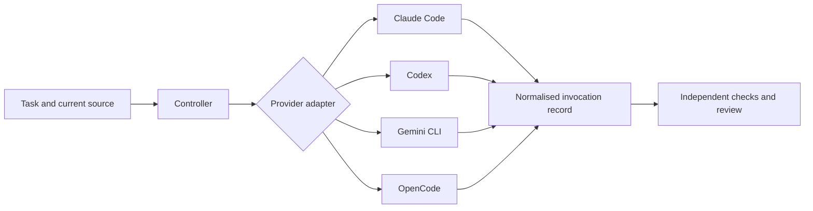
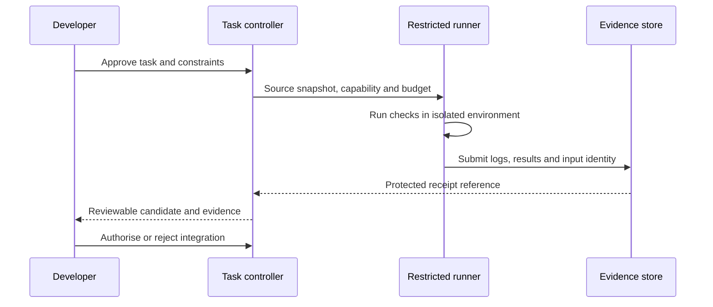

# Context to Commit: Implementation

A practical build sequence for the system described in [ARCHITECTURE.md](ARCHITECTURE.md). The starting point is deliberately small: a Python reading queue, a reproducible failure, a Git worktree and the local `harness.py` contained in [MASTERPLAN.md](MASTERPLAN.md). After that works, the same records and rules can be used to design a service that coordinates coding agents across machines.

The instructions below distinguish commands that can be run now from improvements that need separate engineering. They assume a repository you own and trust. No step requires an external coding agent until the optional handoff exercise.

## 1. What the first implementation must prove

The local exercise is finished only when all of the following have been observed:

- A known failing test exists before the fix.
- A named task creates its own worktree without changing the primary checkout.
- The context file contains selected source and discloses missing or shortened material.
- A test receipt records whether the test passed and whether it modified source files.
- A passing receipt stops applying after a later edit.
- An altered evidence file causes the audit command to fail.
- A new session can use the saved handoff without the old conversation.
- The developer can explain which parts of the setup are not security controls.

A working demonstration is not a production permission system. Do not connect the local program to credentials, production data or untrusted repositories.

## 2. Requirements and workspace

Use Python 3.11 or newer, Git and an editor. The walkthrough uses a Unix compatible shell. On Windows, the same files can be created in an editor and the Python commands run in PowerShell, but commands such as `cat`, `mkdir -p` and multiline quoting need adjustment.

From the `context-to-commit` repository root, confirm the masterplan is present:

```bash
python3 --version
git --version
test -f MASTERPLAN.md
```

Run the exercise inside `examples/reading-queue/`. That directory becomes an independent training repository. Keep it disposable and do not stage it in the publication repository. A nested Git directory can otherwise be treated as a Git link when added from its parent. For a public release, either exclude `examples/reading-queue/` and `examples/reading-queue_worktrees/` locally or create the exercise outside the publication checkout.

```text
context-to-commit/
    MASTERPLAN.md
    ARCHITECTURE.md
    IMPLEMENTATION.md
    TESTING.md
    examples/
        reading-queue/               independent Git repository
            .gitignore
            harness.py                extracted from MASTERPLAN.md
            reading_queue.py
            tests/
                test_reading_queue.py
            .worklog/                 local, ignored
        reading-queue_worktrees/
            READ01/                   created by the harness
```

The directory `examples/reading-queue_worktrees/` is created later, beside the training repository. It is not a Git subdirectory of the publication and should not be committed as documentation. If you choose another directory, adjust the commands consistently.

## 3. Prepare the deliberately defective application

The code below creates a small problem with an exact expected result. Completing a reading entry twice currently adds two to the count. The correct behaviour is to count the transition from incomplete to complete only once.

```bash
mkdir -p examples/reading-queue/tests
cat > examples/reading-queue/.gitignore <<'EOF'
.worklog/
__pycache__/
*.pyc
EOF

cat > examples/reading-queue/reading_queue.py <<'EOF'
class ReadingQueue:
    def __init__(self):
        self.books = {}
        self.completed_count = 0

    def add(self, book_id: str, title: str):
        if book_id in self.books:
            raise ValueError("book identifier already exists")
        self.books[book_id] = {"title": title, "done": False}

    def complete(self, book_id: str):
        book = self.books[book_id]
        book["done"] = True
        self.completed_count += 1  # Deliberate defect
EOF

cat > examples/reading-queue/tests/test_reading_queue.py <<'EOF'
import unittest
from reading_queue import ReadingQueue


class ReadingQueueTests(unittest.TestCase):
    def test_completion_is_idempotent(self):
        queue = ReadingQueue()
        queue.add("bk1", "The River")
        queue.complete("bk1")
        queue.complete("bk1")
        self.assertEqual(queue.completed_count, 1)

    def test_two_books(self):
        queue = ReadingQueue()
        queue.add("bk1", "The River")
        queue.add("bk2", "The Bridge")
        queue.complete("bk1")
        queue.complete("bk2")
        self.assertEqual(queue.completed_count, 2)

    def test_missing_book(self):
        queue = ReadingQueue()
        with self.assertRaises(KeyError):
            queue.complete("absent")
EOF
```

Run the tests before using the harness:

```bash
cd examples/reading-queue
python3 -m unittest discover -s tests -v
cd ../..
```

**Expected:** the idempotency test fails; the other two pass. An unsuccessful exit code is correct here. It establishes that the regression test is capable of exposing the problem. Do not edit the defect in the primary checkout yet.

## 4. Recover the exact reference program from the masterplan

`MASTERPLAN.md`, section **22.3 Complete `harness.py`**, contains the full executable program. Rather than maintaining a second manually edited copy, extract that listing and compile it. The script below is run from the publication repository root. It stops if the expected heading or code fence cannot be found.

```bash
python3 - <<'PY'
from pathlib import Path

source = Path("MASTERPLAN.md").read_text(encoding="utf-8")
heading = "### 22.3 Complete `harness.py`"
if source.count(heading) != 1:
    raise SystemExit("Expected exactly one reference implementation section")
section = source.split(heading, 1)[1]
if "\n```python\n" not in section:
    raise SystemExit("Python code fence not found")
program = section.split("\n```python\n", 1)[1].split("\n```\n", 1)[0]
if not program.startswith("#!/usr/bin/env python3"):
    raise SystemExit("Unexpected reference program")
out = Path("examples/reading-queue/harness.py")
out.write_text(program.rstrip() + "\n", encoding="utf-8")
print(f"Wrote {out}: {len(program.splitlines())} lines")
PY

python3 -m py_compile examples/reading-queue/harness.py
```

This avoids the common failure in which a manual copy of a code listing diverges from the actual working example. Treat the source extraction as a development convenience, not as a general parser for arbitrary Markdown. If the masterplan's heading or layout changes, update the extraction script deliberately.

The program supports six commands:

| Command | Operation | Where its records go |
|---|---|---|
| `start` | Create task worktree and record the baseline | `.worklog/tasks/` |
| `context` | Build an explicit, bounded source package | `.worklog/context/` |
| `check` | Run fixed unittest discovery and record evidence | `.worklog/checks/` |
| `audit` | Check applicability of the latest test receipt | Reads existing records |
| `handoff` | Record current task and test state | `.worklog/handoffs/` |
| `propose` | Record a source linked observation | `.worklog/proposed_memories.jsonl` |

No command invokes Claude Code, Codex, Gemini CLI or OpenCode automatically. That boundary is intentional.

## 5. Establish the baseline Git commit

The harness requires a clean primary worktree when creating a task. Initialise the independent training repository and commit the defective starting point.

```bash
cd examples/reading-queue
git init
git config user.name "Local Exercise"
git config user.email "local.exercise@example.invalid"
git add .gitignore reading_queue.py tests/test_reading_queue.py harness.py
git commit -m "Establish reading queue test baseline"
git status --short
git rev-parse HEAD
cd ../..
```

Use your usual Git identity instead of the exercise identity if you prefer. The address ending in `.invalid` is a deliberately nonroutable placeholder. Nothing is pushed to a remote repository.

A clean status and a recorded commit are part of the experiment. If the directory already has a Git repository with important work, do not reinitialise or delete it. Create a new disposable directory instead.

## 6. Define the task before assigning it

A minimal contract for the reading queue:

```yaml
id: READ01
goal: Make completion idempotent
existing_failure: A second completion increments completed_count again
acceptance:
  - Completing the same entry twice counts once
  - Completing two different entries counts twice
  - Completing an unknown entry still raises KeyError
scope:
  - reading_queue.py
  - tests/test_reading_queue.py
prohibited:
  - installing dependencies
  - modifying release or credential configuration
verification:
  - python -m unittest discover -s tests -v
```

The local `start` command currently saves the goal and acceptance string, not the complete YAML contract. Keep the full task definition in reviewed project documentation if other developers need it. A deployed controller should validate the richer contract itself.

Create the task:

```bash
cd examples/reading-queue
python3 harness.py start READ01 \
  --goal "Make book completion idempotent" \
  --acceptance "Completing a book twice counts it once"
cd ../..
```

The expected new worktree is `examples/reading-queue_worktrees/READ01/`. The primary repository remains on its baseline branch. Inspect the result:

```bash
cd examples/reading-queue
git worktree list
cat .worklog/tasks/READ01.json
cd ../..
```

Record the base revision before asking any agent to edit. Worktree creation is not process isolation; no command here restricts access to files outside the repository.

## 7. Assemble the first context package

Build context from named files rather than an entire directory:

```bash
cd examples/reading-queue
python3 harness.py context READ01 \
  reading_queue.py tests/test_reading_queue.py
cat .worklog/context/READ01.md
cd ../..
```

The generated file contains the task, base commit, current workspace digest, selected source and a list of omissions or truncated excerpts. It is a snapshot of information selected for the next operation, not a permanent memory store.

### Rules for adding source

Begin with the function being changed and its test. Add callers when the interface can affect them, relevant configuration when it governs behaviour, and a current design decision when the implementation depends on it. Do not add unrelated files to fill the context window.

For any retrieved item preserve:

```yaml
path: reading_queue.py
source_revision: <calculated-digest>
reason: implementation under test
trust: repository_source
completeness: full
```

The local implementation places the digest in its context text. A production assembler should also store a structured manifest and report omissions by category. It should reject sensitive files before their contents are read.

## 8. Capture the failing check

```bash
cd examples/reading-queue
python3 harness.py check READ01
# Expected nonzero status because the defect has not been repaired.
python3 harness.py audit READ01
# Expected nonzero status because the latest test failed.
cd ../..
```

In an interactive shell, the failed command does not prevent the next command unless strict error handling is enabled. In a CI job, an expected failure must be handled explicitly rather than silently ignored.

Open the latest receipt in `.worklog/checks/READ01/` and inspect `test_outcome`, `exit_code`, `workspace_mutated`, `before.digest`, `after.digest`, `stdout_sha256` and `stderr_sha256`.

**Interpretation:** a failed test remains a failed test, even if the files are unchanged. The receipt proves that a process with a particular command and observed exit status ran in the local environment. It does not prove how the application would behave in production.

## 9. Repair within the task worktree

Only the task worktree should receive the change. Edit `examples/reading-queue_worktrees/READ01/reading_queue.py` so `complete` becomes:

```python
def complete(self, book_id: str):
    book = self.books[book_id]
    if not book["done"]:
        book["done"] = True
        self.completed_count += 1
```

This is idempotent for the single process toy program. It does not guarantee atomicity across several processes or a database. For shared storage, the condition and update may need an atomic transaction or conditional update, plus concurrency tests.

Inspect the worktree diff:

```bash
cd examples/reading-queue_worktrees/READ01
git diff -- reading_queue.py
git diff --check
cd ../../..
```

Then run the check from the primary training checkout:

```bash
cd examples/reading-queue
python3 harness.py check READ01
python3 harness.py audit READ01
python3 harness.py handoff READ01
cd ../..
```

**Expected:** the test passes, no Git visible file changes during the check, the audit exits successfully, and the handoff is written. These are observed local properties, not a security certification.

## 10. Preserve a decision without turning a guess into policy

The program can record a proposed observation:

```bash
cd examples/reading-queue
python3 harness.py propose READ01 \
  --source reading_queue.py \
  --statement "Repeat completion does not increment the count"
cd ../..
```

The record includes a source hash and the state `proposed`. It is not automatically accepted project guidance. A developer who agrees with the rule should place the accepted rationale in a reviewed and tracked decision record, for example `docs/decisions/0001-reading-queue-idempotency.md` in the main publication or application repository.

A durable decision should explain the problem, alternatives, accepted approach, consequences and evidence. Avoid copying transient output, personal information or credentials into long term records.

## 11. Prove that an old pass does not follow a new edit

Add a harmless comment to the fixed task worktree:

```bash
printf '\n# Verification invalidation exercise\n' >> examples/reading-queue_worktrees/READ01/reading_queue.py
cd examples/reading-queue
python3 harness.py audit READ01
cd ../..
```

**Expected:** the audit fails because the Git visible source digest differs from the one recorded in the last passing check. The program does not need to decide whether the comment is harmless; it simply refuses to claim that a changed revision was checked. Run `check` again before requesting a passing audit.

A later production build fingerprint needs more than this local manifest. Installed packages, ignored generated inputs, environment variables that affect builds, tools and external services may change results. Record what the fingerprint does and does not cover.

## 12. Hand work to another session or provider

Generate a fresh handoff after the latest check:

```bash
cd examples/reading-queue
python3 harness.py check READ01
python3 harness.py handoff READ01
cat .worklog/handoffs/READ01.md
cd ../..
```

The receiving engineer or coding agent should be given the approved task contract, current worktree, handoff, relevant source and latest test receipt. Do not supply a flattering summary of the outgoing agent's work instead of those records.

Use a short receiving instruction:

> Review task `READ01` against the current worktree and the handoff. Confirm the exact files changed and the evidence behind the latest check. Identify any unsupported claim, missing test or unresolved risk. Do not edit the source during this review.

The receiving agent's ability to follow a written read only instruction is not equivalent to enforced read only access. For an actual reviewer, use provider settings and a filesystem or runtime restriction that prevents writes. The correct result of this exercise is a review report supported by current files, not merely an agreeable response.

### Provider choice

Claude Code, Codex, Gemini CLI and OpenCode have programmatic command modes, but flags and approval behaviour differ across versions. Check each installed `--help` and the provider documentation before invoking it. Begin with supervised sessions. Do not make a generic adapter that silently grants blanket shell or network permissions just to accommodate different command syntax.

## 13. Introduce provider adapters only after the local workflow works

An adapter solves a specific problem: converting a neutral task request into an invocation supported by one provider, then capturing the result without equating the provider's final message with successful verification.



A neutral request should carry a task ID, role, working directory, context bundle reference, explicit capabilities, timeout and artifact location. A neutral response should carry the process exit code, invocation ID, touched files, captured events and unverified agent report. An external check decides whether the resulting code is acceptable.

### A useful adapter interface

The following Python types describe the boundary. They do not invoke any vendor and they do not enforce a sandbox.

```python
from dataclasses import dataclass
from pathlib import Path
from typing import Literal, Protocol

Role = Literal["research", "implement", "review"]


@dataclass(frozen=True)
class Invocation:
    task_id: str
    role: Role
    workspace: Path
    context_path: Path
    timeout_seconds: int
    permitted_operations: frozenset[str]


@dataclass(frozen=True)
class InvocationResult:
    provider: str
    process_exit_code: int | None
    artifact_path: Path
    reported_status: str
    verified: bool = False


class AgentAdapter(Protocol):
    def run(self, request: Invocation) -> InvocationResult: ...
```

An implementation should validate paths and permissions before launching a subprocess. Start with a no execution adapter that writes the proposed command to an artifact and returns it for inspection. Only then add a runner that enforces timeouts, resource restrictions, credential policy and output capture.

### Adapter acceptance requirements

An adapter is not complete until it can: distinguish timeout, provider error and a valid response; record tool version; avoid leaking authentication material into logs; cancel a running operation; handle invalid or partial structured output; and preserve useful evidence if the session ends unexpectedly. A review adapter must be proven unable to write to the protected source, not merely told to refrain.

MCP integration for tools and ACP integration for agent clients can be explored after these tests. Neither protocol automatically supplies task memory, approval authority or identical provider semantics.

## 14. Plan for multiple writers without allowing uncontrolled edits

Default to one writer per worktree. This limits accidental collisions while permitting read only research and review in parallel. To split a larger change, create a separate worktree and task contract for each independently testable part.

A task owner should record:

```yaml
task_id: READ01
writer: assigned-implementer
base_commit: <actual-commit>
owned_paths:
  - reading_queue.py
  - tests/test_reading_queue.py
read_only_participants:
  - reviewer
integration_owner: human-maintainer
```

File ownership is not enough to prevent semantic conflicts. Two changes to different modules can disagree about the same API contract. Integrate through a review that checks the combined system, not simply whether Git reports a clean merge.

For several concurrent workers, introduce transactional leases. Each lease needs an owner, a generation or version, a deadline and a recovery procedure. A stale worker must not be allowed to resume a write after another worker has legitimately acquired ownership.

## 15. Separate durable knowledge from local runtime records

The local program writes to `.worklog/`, which Git ignores. That is appropriate for temporary logs, but it cannot serve as the sole memory for a project that moves between machines.

Use three destinations:

| Record | Recommended location | Reason |
|---|---|---|
| Project conventions and reviewed architecture decisions | Versioned repository documents | Reviewable and available in a fresh clone |
| Task state and ownership across machines | Shared database or existing issue system with versioned updates | Consistent coordination and recovery |
| Logs, receipts and sensitive execution artifacts | Protected object store with retention rules | Evidence survives local failure without public exposure |

Do not commit raw environment files, credentials, private customer data, complete tool transcripts or sensitive error traces just to make them durable. Durability also requires controlled access and deliberate deletion.

## 16. Move from the local example to a deployed runner

The first meaningful infrastructure step is not adding more coding agents. It is establishing a safe place for them to run.

### Minimum execution controls

1. Run work in a disposable environment with a dedicated identity.
2. Provide only the repository snapshot and specific required dependencies.
3. Remove production secrets and set network policy before the agent starts.
4. Apply CPU, memory, wall time and output limits.
5. Treat the repository's test scripts and dependency hooks as executable untrusted code.
6. Send logs and receipts to storage the task writer cannot modify.
7. Require a separate, authenticated approval for production changes.
8. Destroy the disposable environment after recording and verifying the result.



Do not assume a container with default settings provides adequate security against a hostile repository. The actual threat model governs whether operating system restrictions, remote virtual machines, controlled egress or stronger isolation are necessary.

## 17. Add automatic verification and integration controls

A small continuous integration workflow should begin with documentation checks and the reference program's automated tests. It should not run arbitrary agent actions or read production secrets on untrusted pull requests.

An illustrative GitHub Actions job, to be added only when the referenced test file exists:

```yaml
name: Validate reference implementation
on:
  pull_request:
  push:
    branches: [main]
permissions:
  contents: read
jobs:
  test:
    runs-on: ubuntu-latest
    timeout-minutes: 10
    steps:
      - uses: actions/checkout@v4
      - uses: actions/setup-python@v5
        with:
          python-version: '3.11'
      - run: python -m unittest discover -s tests -v
```

For production use, pin third party actions to reviewed immutable commit SHAs, apply current organisation restrictions, and ensure the test path matches the repository. The job is not deployable unchanged if `tests/` has not been added to the publication repository. [TESTING.md](TESTING.md) provides a concrete test suite to place there.

### Integration gate

Do not merge because the agent said `done` or because an old receipt was green. The gate checks the current commit and required tests, review findings, dependency changes, scope and approvals. An external approval or write operation must remain separate from the coding agent's normal tool permissions.

## 18. Measure the system before optimizing it

Keep a record of representative tasks, not just successful demos. For each task capture:

| Measurement | Practical definition |
|---|---|
| Completion | Acceptance criteria met and reviewed |
| Recovery | New session completes next correct step from handoff alone |
| Context quality | Required source present, irrelevant source limited, omissions disclosed |
| Verification validity | Receipt matches exact tested source and relevant environment |
| Rework | Human or agent time spent repairing incorrect changes |
| Cost | Model calls, tools, runner time, review and repeat attempts |
| Security | Out of scope actions denied and recorded |

Compare new orchestration, retrieval or model choices against a fixed task set. Small task counts produce uncertain conclusions. Report the number of trials and important differences in tools and configuration. A more complex system is justified only if it improves accepted outcomes or materially reduces risk.

## 19. Build sequence and completion gates

| Phase | Implementation | Evidence required |
|---|---|---|
| 1 | Reproducible reading queue defect | Failing regression test on baseline |
| 2 | Git task worktree and local task record | Clean main checkout, inspectable branch |
| 3 | Selected source context and omissions | Context file with hashes and explicit omissions |
| 4 | Independent unittest receipt and audit | Failed baseline, passing fix, stale check rejection |
| 5 | Source backed observation and session handoff | New session correctly identifies task and remaining work |
| 6 | Adapter contract and supervised reviewer | Real invocation logged, no unsupported permission claim |
| 7 | Isolated runner and protected evidence | Tests proving denied access and tamper detection |
| 8 | Shared task state and concurrent ownership | Recovery and lease conflict exercises |
| 9 | Continuous evaluation and release controls | Versioned task suite and reviewable release evidence |

Phases 1 through 5 are supported by the local reference in `MASTERPLAN.md` and the commands above. Phase 6 requires an actual provider integration before it can be called complete. Phases 7 through 9 are engineering work, not features of the sample Python program.

## 20. Maintenance and recovery

Inspect Git and durable records before attempting recovery. If worktree creation was interrupted, run `git worktree list` and compare the branches and paths against the task ledger. Never run an indiscriminate cleanup command against someone else's work.

When a test previously passed but now fails, compare the relevant source and environment identities first. Do not assume the model forgot something. When a session loses context, rebuild it from current task facts and files instead of pasting the entire conversation back into the next session.

A project can keep this system maintainable by assigning owners for the task schema, runner, verification policy, knowledge register and adapter compatibility. Changes to those interfaces should be tested independently and reflected in the architecture decision register.

## 21. Next actions

Run [TESTING.md](TESTING.md) against the extraction of `harness.py` from `MASTERPLAN.md`. Retain a test log from a clean environment. Record any divergence between the supplied code and the behaviour described here as a defect; update both source and documentation in the same pull request.

Only after that evidence exists should you expand beyond the local exercise. The first genuine multiagent milestone is a read only review or neutral handoff whose access restrictions and output can be independently inspected. The first production milestone is an isolated runner with protected evidence, not an agent that can run more commands.

## Technical references

- [MASTERPLAN.md](MASTERPLAN.md), especially sections 4, 10, 15, 18 and 22 through 24.
- [ARCHITECTURE.md](ARCHITECTURE.md), task and evidence interfaces.
- [Git worktrees](https://git-scm.com/docs/git-worktree)
- [Python unittest](https://docs.python.org/3/library/unittest.html)
- [Python subprocess](https://docs.python.org/3/library/subprocess.html)
- [GitHub Actions security](https://docs.github.com/en/actions/reference/security/secure-use)
- [Claude Code documentation](https://code.claude.com/docs/en/overview)
- [Codex repository instructions](https://developers.openai.com/codex/guides/agents-md)
- [Gemini CLI headless mode](https://github.com/google-gemini/gemini-cli/blob/main/docs/cli/headless.md)
- [OpenCode CLI](https://opencode.ai/docs/cli/)
