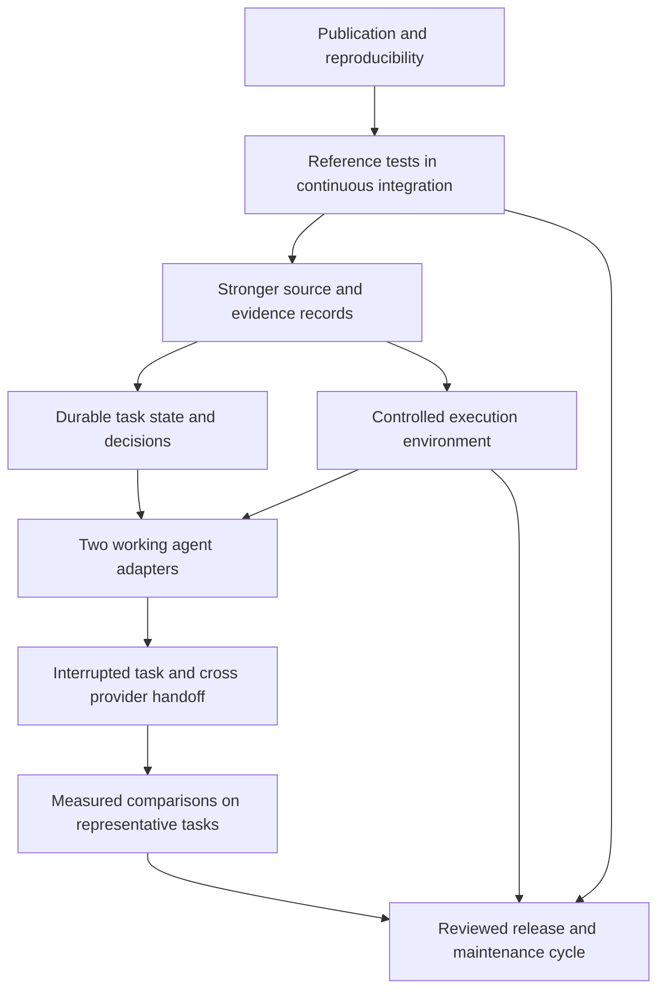

# Context to Commit: Roadmap

A working plan for taking the ideas in [MASTERPLAN.md](MASTERPLAN.md) from a local exercise to a system that developers can test, understand, and maintain. The purpose of this file is to show what exists, what needs to be built, and the evidence required before calling any part of the work complete.

The roadmap is arranged by dependencies rather than promised dates. Priorities may change when a security finding, failed experiment, or contributor's research provides a better reason to do something first.

## Where the project stands

Context to Commit currently has a detailed engineering proposal and a small reference implementation printed in the masterplan. The reference program can create task worktrees, assemble context from selected source files, run a fixed local test command, produce verification receipts, reject stale or altered evidence under its defined checks, record proposed observations, and prepare a session handoff. [IMPLEMENTATION.md](IMPLEMENTATION.md) explains how to extract and run it. [TESTING.md](TESTING.md) specifies the exercises.

Those capabilities describe the **local teaching implementation**, not a deployed coordination service. The test results reported in the documentation apply to the stated code and test environments. They do not demonstrate that a Git worktree confines processes, that local receipts cannot be forged by someone with filesystem access, or that four coding agents have been integrated and tested together.

| Area | Current state | What still needs proof |
|---|---|---|
| Engineering plan | Documented in the masterplan and architecture | Reader comprehension, consistency across examples |
| Local task lifecycle | Implemented as a small command line program | Crash recovery, simultaneous tasks, complete failure handling |
| Source selection | Explicit paths, exclusions, size bounds, omission notices | Retrieval quality, policy enforcement, filesystem race resistance |
| Verification | Local tests, exit codes, source manifests, receipt audits | Reproducible environment, protected evidence, broader inputs |
| Memory | Source linked proposed observations | Durable reviewed decisions, replacement rules, multi machine access |
| Session renewal | Neutral handoff file | Automatic reconciliation and tested continuation with more than one provider |
| Provider coordination | Neutral interface and operating rules documented | Real adapters, capability enforcement, cancellation, malformed output handling |
| Execution isolation | Threat model and required controls documented | Restriction tested in a disposable runner or virtual machine |
| Evaluation | Metrics and experimental procedures documented | Repeated comparative runs with published task definitions and results |
| Publication workflow | Supporting documents prepared | Live CI status, selected licence, review and a tagged release |

**Status language** in this file is deliberate:

- **Documented:** a proposed rule, interface, or procedure is written down.
- **Locally exercised:** a specific behavior has been tested in the reference environment. Its limits still apply.
- **In progress:** work has an active, linked issue or pull request and identifiable owner. Do not apply this label just because the item appears here.
- **Blocked:** a prerequisite, decision, or external dependency prevents meaningful progress.
- **Verified:** the acceptance checks listed for the item were run on the actual proposed revision, with inspectable evidence.
- **Released:** a maintainer has published a version or Git tag and recorded the changes in [CHANGELOG.md](CHANGELOG.md).

A finished document is not the same thing as a finished feature. The status of a feature must be justified by its implementation and its checks.

## How the work fits together

*Reading the diagram:* the reference needs a repeatable baseline before its evidence format is hardened. Reliable handoffs need persistent state and real provider integration. A production claim additionally needs a tested execution boundary. Research and documentation can progress alongside these stages, but they cannot substitute for the missing checks.

## Priority 0: Make the published examples reproducible

The first user should be able to clone a revision, follow the exercise without guessing at missing files, and get the stated failure and recovery results. This is a smaller undertaking than building orchestration, and its results become the baseline for every later experiment.

**Work to do**

1. Establish an executable example under `examples/`, with the reading queue and its tests. Choose one source of truth for `harness.py`: either generate it from the fenced listing in `MASTERPLAN.md`, as described in [IMPLEMENTATION.md](IMPLEMENTATION.md), or deliberately make a tracked source file canonical and verify that the published listing matches it. Do not let both versions drift.
2. Make the test suite described in [TESTING.md](TESTING.md) runnable after a fresh checkout. Keep temporary worktrees, `.worklog/`, generated files, test caches, and credentials out of the publication commit.
3. Add a CI job that checks Markdown links and syntax, extracts or compares the code listing, executes the local tests, and reports a failing status when any required check fails.
4. Verify the setup on a clean machine or clean container. Record Python, Git, platform, commands, and observed outcomes. Keep the initial intentionally failing application test clearly separate from the final passing harness tests.
5. Confirm that source paths, commands, and requirements agree across the masterplan, architecture, implementation guide, testing guide, and security policy.
6. Select and record the documentation and code licences before soliciting substantial external contributions. The licence choices are a maintainer decision; this roadmap does not assign them automatically.

**Acceptance gate**

A reader following the published instructions, starting with a clean checkout and no provider subscription, can reproduce the defect, run the reference checks, create a handoff, and see a real nonzero exit status for failed or stale evidence. CI runs the same checks. A maintainer can identify the Git revision and exact code used.

**Not sufficient:** a screenshot of successful terminal output from an unrelated working directory, or an agent reporting that the example works.

## Priority 1: Make verification records harder to misuse

The existing local manifest is useful but not a complete description of a build. Ignored configuration, installed dependencies, environment variables, generated files, external services, and filesystem changes during hashing may influence the outcome without changing the current manifest.

**Work to do**

- Specify a versioned record for the task, input manifest, command, environment, output artifacts, and check result. Preserve the distinction between a failed test and a test that modified source. Both may occur together.
- Define what is inside the verified source boundary. Make excluded inputs visible; do not label a partial manifest as complete build provenance.
- Record the Git base revision, tracked changes, relevant untracked files, file modes where applicable, test command, runtime version, dependency lockfile identity, exit code, timeout classification, and digest of captured logs. Include a policy for secrets and sensitive logs.
- Add tests for symlinks, paths outside the workspace, malformed records, interrupted file writes, concurrent edits, missing artifacts, changed lockfiles, and changed test inputs.
- Ensure the audit command returns a failure status when the required receipt is missing, failed, corrupted, or no longer matches the checked source.
- Plan a protected artifact store for stronger deployments. Locally stored hashes show changes to bytes, but they do not establish an independent or trusted signer.

**Acceptance gate**

A deliberately failing test can never be reported as passing merely because it changed files. A check against an earlier revision is rejected after a relevant source edit. Tampered or missing evidence fails closed. The documentation states which build inputs remain outside the record.

**Decision before implementation:** whether the teaching program stays deliberately limited to Git visible source or expands to a declared input manifest with additional environmental captures. A wider record is useful, but an inaccurate claim of completeness is worse than an explicit boundary.

## Priority 2: Move important state out of the chat and the local machine

A handoff stored in an ignored directory is a useful local exercise. It is not durable coordination for multiple developers or machines. The system needs to distinguish versioned project knowledge from private runtime artifacts and from the short lived transcript inside a provider session.

**Work to do**

- Store reviewed project facts and design decisions in versioned documents, with clear authority and a way to supersede obsolete decisions. A vector index may support lookup but must never become the only copy of authoritative material.
- Define task identity, ownership, expected revision, status transitions, and recovery behavior. For a shared task store, use transactions or compare and swap semantics rather than last writer wins updates.
- Separate private receipts and logs from shareable decisions. Add retention, access control, redaction, backups, and a documented deletion path for sensitive data.
- Make checkpoints reproducible: task scope, current commit and working changes, prior checks, open questions, rejected attempts, and permitted next action.
- Test interruption after each state change. In particular, an interruption after worktree creation but before task record persistence must leave a discoverable and repairable state.
- Add reconciliation when a worktree, task record, and remote state disagree. Never resolve a conflict by silently overwriting another contributor's changes.

**Acceptance gate**

On a fresh machine, a developer can retrieve the task contract, recover the relevant source and approved decisions, verify recorded evidence, and continue without the original chat. When two sessions attempt to claim or change the same task, the system detects the conflict rather than accepting two concurrent writers.

## Priority 3: Demonstrate real coordination between two coding agents

Adding adapters for four products at once would increase the test surface without addressing the most important question: can the second agent understand the task and its evidence without inheriting the first agent's private conversation?

**Work to do**

1. Choose two installed coding agent interfaces. The selection should be based on available supported command or SDK functionality, not an assumption that either model is always better at a particular role.
2. Define a common invocation request containing role, task identity, workspace, context reference, permission profile, timeout, and artifact destination.
3. Capture the provider version, process result, cancellation and timeout events, output artifacts, and any changed files. Keep provider reported completion separate from the result of independent checks.
4. Enforce the reviewer role outside natural language instructions. A reviewer must be unable to modify the source even when its prompt or an untrusted file requests a write.
5. Demonstrate two cases: a writer followed by a read only reviewer, and a stopped task resumed by another provider from a neutral checkpoint.
6. Exercise malformed structured output, interrupted streaming, provider unavailability, cancellation, unexpected writes, and permission denial.

**Acceptance gate**

A recorded run demonstrates a real two provider handoff on the same task, with one controlled writer at a time, reconstructable inputs and outputs, and checks belonging to the final code state. The second provider does not need the first provider's proprietary transcript. A failure to restore enough context is recorded as a failed handoff.

**Not yet required:** a complex routing model, several concurrent writers, or claims that every vendor implements the same approval and streaming semantics.

## Priority 4: Build a restricted execution environment

This work must precede unattended use on untrusted repositories. A Git worktree isolates versions of files, not process authority. A test command can execute arbitrary repository code even if the command has no shell interpolation.

**Work to do**

- Run agent tools and repository tests inside disposable containers or stronger isolated environments, using an identity dedicated to the task.
- Restrict filesystem mounts, network egress, environment variables, process lifetime, CPU, memory, and log volume. Default to no production credentials.
- Keep approval and policy evaluation outside the workspace that the coding agent can edit.
- Separate external reads from actions that send data, change services, publish packages, merge code, or deploy. Require authenticated approval for consequential operations.
- Prevent ordinary task writers from modifying protected receipts and the verification gate itself.
- Test malicious dependency scripts, hostile repository instructions, attempts to read outside the workspace, unapproved network calls, timeouts, and cleanup after cancellation.

**Acceptance gate**

A hostile fixture fails to read a protected host file or reach a disallowed network destination. A review task cannot modify source. Logs and credentials are not exposed through a prompt or routine error report. The denied actions are observed in tests against the actual runner, not merely described in [SECURITY.md](SECURITY.md).

**Boundary:** even a passing local security test is not a certification. The threat model and provider configuration need independent review before sensitive use.

## Priority 5: Measure what the system improves

A second agent, more context, or an earlier session restart should not become default policy without evidence of a benefit. Cost reductions that increase missed defects or human rework are not savings.

**Work to do**

- Prepare a representative private task collection with ordinary bugs, feature work, repository exploration, ambiguous requirements, regression repair, interrupted sessions, and security boundary cases.
- Preserve the task text, starting revision, test oracle, allowed tools, and acceptance criteria. Keep evaluation cases separate from the project's retrieved task memories.
- Compare one writer with and without an independent reviewer. In separate experiments compare focused retrieval against broad context, and neutral handoffs against conventional session summaries.
- Record completion, cost per accepted task, time to acceptance, human correction time, escaped defects, context omissions, and recovery success. Include the sample size, provider version, and relevant uncertainty.
- Reject changes that only improve token usage while making outcomes worse. Record negative or inconclusive results as carefully as positive ones.

**Acceptance gate**

A second developer can rerun the published procedure and inspect task level outcomes. The report distinguishes measured findings from design recommendations. It includes failures and does not turn a single anecdote into a percentage improvement claim.

Research methods and open questions live in [RESEARCH.md](RESEARCH.md). The metric definitions and test conditions live in [TESTING.md](TESTING.md).

## Priority 6: Prepare a maintainable public release

Release readiness depends on the earlier evidence. A repository can be valuable while still experimental, but its readers must be able to see that status immediately.

**Work to do**

- Complete the licence decision, contributor guide, security disclosure route, revisioned test procedure, and release notes.
- Use a protected default branch, appropriately scoped workflow permissions, and reviewed updates to CI. Require only CI checks that actually exist and have passed on the intended branch.
- Create the final `README.md` only after the repository contents and demonstrated capabilities have been reconciled.
- Publish a release from a specific Git tag. Keep the release notes in sync with [CHANGELOG.md](CHANGELOG.md) and disclose known limitations.
- Define a maintenance routine for broken vendor interfaces, security reports, outdated sources, example regressions, and contributions.

**Acceptance gate**

The public release points to a specific commit; a clean checkout reproduces its published local tests; the licence and reporting route are visible; the README claims no capability beyond what the release demonstrates. A reader knows which parts remain experimental.

## A useful first issue queue

These are suggested work items, **not existing GitHub issue numbers**. Create an issue when work is ready to be owned and reviewed. Preserve the identifier in the issue title or description if it remains helpful.

| ID | Work item | Dependency | Evidence to attach | Priority |
|---|---|---|---|---|
| PUB01 | Verify all six technical documents against the reference listing | None | Link check and source consistency report | First |
| PUB02 | Choose licence scope for prose and executable examples | Maintainer decision | Published terms and reviewed file scope | First |
| REF01 | Make the reading queue exercise reproducible from a clean clone | PUB01 | Environment record and successful setup run | First |
| REF02 | Run the tests described in `TESTING.md` in CI | REF01 | Successful CI run and deliberate failing case | First |
| EVD01 | Version the receipt and input manifest schemas | REF02 | Schema checks and migration policy | Next |
| EVD02 | Distinguish missing inputs, failure, mutation, stale checks and tampering | EVD01 | Negative test outcomes | Next |
| MEM01 | Separate versioned decisions from ignored local `.worklog/` records | REF01 | Recovery from a new clone | Next |
| MEM02 | Recover interrupted and conflicting task transitions | MEM01 | Crash and concurrent writer tests | Next |
| INT01 | Implement and test one read only adapter | REF02 | Captured invocation and denied write test | After baseline |
| INT02 | Complete a two provider handoff | MEM02, INT01 | Reproducible cross provider run | After baseline |
| SEC01 | Build and test a restricted runner | REF02 | Denied filesystem and network probes | Required for unattended use |
| EVA01 | Run a small controlled comparison and publish failures | INT02, REF02 | Task level dataset and results | After integration |
| REL01 | Audit release claims, documents, tests and disclosures | Relevant prior gates | Release checklist and linked tag | Last |

No contributor should have to guess whether an issue requires code, documentation, a security decision, or an experiment. Each issue should state the expected change, the relevant file or interface, and its acceptance test. See [CONTRIBUTING.md](CONTRIBUTING.md) for the review process.

## Risks that could change this plan

| Risk | Early signal | Response |
|---|---|---|
| Documentation and source diverge | Example copied from the masterplan fails while a local script succeeds | Enforce listing extraction or parity checks in CI |
| Context omits critical project rules | Repeated repairs or design contradictions after retrieval | Record omissions, retrieve by dependency and authority, add targeted retrieval tests |
| Stored memory becomes misleading | Old decision returned as active, or unexplained conflicting facts | Require provenance, review and explicit supersession |
| Local receipts are mistaken for independent evidence | Claims of trusted execution derived from self written hashes | Require protected storage and a separate runner for higher assurance |
| Different agents edit the same scope | Conflicting diffs or unexpected overwrites | Assign one writer per workspace or enforce path ownership and coordination |
| Provider updates break adapters | Changed flags, output format, or permission behavior | Test against identified versions and fail closed on unknown behavior |
| Safety controls become optional to make a demo work | Broad file permissions or disabled approvals added during debugging | Stop the integration, restore policy, and write a negative regression test |
| Evaluation becomes marketing | Percentages without task counts or reproducible conditions | Keep a task level record, include negative outcomes and limitations |
| Community work expands beyond maintenance capacity | Unreviewed large pull requests and stale issues | Prefer small changes and mark unsupported directions honestly |

## What is deliberately outside the first implementation

The near term plan does not include unattended production deployment, a cloud hosted commercial service, a general purpose autonomous coding swarm, simultaneous unrestricted writers, a proprietary memory platform, guaranteed recovery of a model's private reasoning, or universal performance claims. These ideas may be revisited only after the smaller system demonstrates real value and its permission boundaries hold under test.

## How to keep this roadmap accurate

A roadmap entry moves to **verified** only when its owner links the implementation, acceptance criteria, test records, and review. It moves to **released** only with the actual release tag. If a proposal becomes obsolete, record why it was abandoned rather than deleting the rationale. Significant changes to scope should update [ARCHITECTURE.md](ARCHITECTURE.md), and research based changes should update [RESEARCH.md](RESEARCH.md).

For ongoing tracking, use GitHub Issues for concrete work and milestones for related acceptance gates. A GitHub Project can provide board or roadmap views, but this Markdown remains the explanation of dependencies and scope. Target dates should be added only after someone has accepted responsibility and examined the actual work.

When a release is made, record reader visible changes in [CHANGELOG.md](CHANGELOG.md). Do not use this roadmap as a substitute for a release history.

## Sources informing the publication process

The technical sources for context, memory, interoperability, and evaluation are maintained in [RESEARCH.md](RESEARCH.md). The operating approach in this roadmap also draws on:

- [GitHub Docs: About Projects](https://docs.github.com/en/issues/planning-and-tracking-with-projects/learning-about-projects/about-projects), for linking issues and pull requests to project views.
- [GitHub Docs: Milestones](https://docs.github.com/en/issues/using-labels-and-milestones-to-track-work/creating-and-editing-milestones-for-issues-and-pull-requests), for grouping work without inventing progress.
- [GitHub Docs: About rulesets](https://docs.github.com/en/repositories/configuring-branches-and-merges-in-your-repository/managing-rulesets/about-rulesets), for reviewable branch and tag restrictions.
- [GitHub Docs: About releases](https://docs.github.com/en/repositories/releasing-projects-on-github/about-releases), for linking a published release to a specific Git tag.

The roadmap is successful when it makes decisions and unfinished work easier to inspect. A growing number of boxes marked complete is not, by itself, progress.
