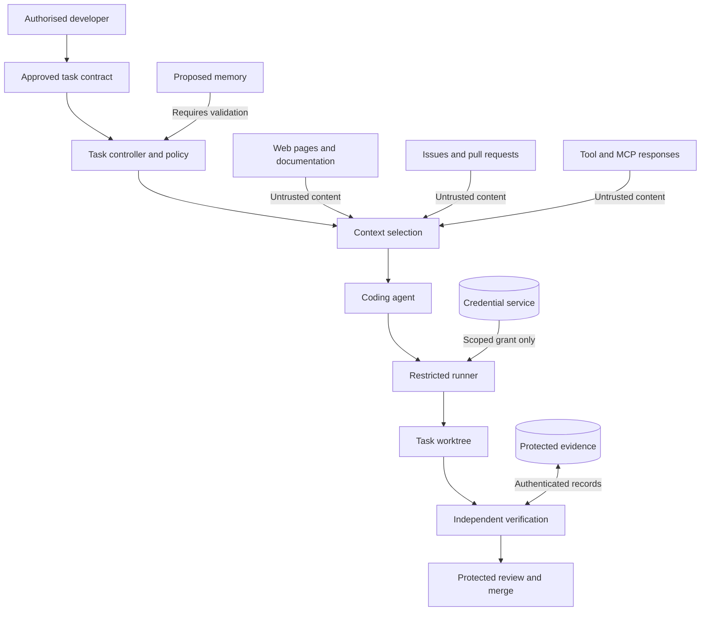

# Security Policy and Engineering Controls

Security is part of the work being built, not a review added after a coding agent has finished. Context to Commit deals with software that can read source, run commands, call services and change files. Those capabilities need boundaries that are enforced by the execution environment, not merely requested in a prompt.

This document covers the repository's educational reference implementation and the controls required before adapting the design for unattended or production use. Read it alongside [ARCHITECTURE.md](ARCHITECTURE.md), [IMPLEMENTATION.md](IMPLEMENTATION.md), [TESTING.md](TESTING.md) and the central [MASTERPLAN.md](MASTERPLAN.md).

## 1. Support, scope and responsible disclosure

### What is supported

The repository currently documents a local learning exercise and a broader engineering architecture. The reference `harness.py` printed in `MASTERPLAN.md` demonstrates task worktrees, bounded source selection, test receipts, source state checks, proposed memories and session handoffs. It is **not** a hardened execution service.

Security corrections should be assessed against the version actually present in the repository. Until the maintainers publish a version support matrix, do not assume that an older revision, copied script or experimental branch receives ongoing fixes. No security certification, independent penetration test, production service agreement or provider endorsement is implied.

A finding is in scope when it affects a property the project claims to provide, such as its file selection restrictions, source evidence handling, audit exit status, worktree bookkeeping or documented safety boundaries. A vulnerability in the user's operating system, a third-party coding agent or a separate dependency should ordinarily be reported to that component's maintainer as well, with an explanation of any impact on Context to Commit.

### Report privately

If you discover a way to cross a documented boundary, disclose credentials, forge a verification result, escape a file restriction or mislead a user about what was verified, do not publish a working exploit or private data in a public issue.

1. Open the repository's **Security** area on GitHub and use **Report a vulnerability** if private vulnerability reporting is enabled.
2. Include the affected revision, environment, expected boundary, observed behaviour and a minimal reproduction using disposable data.
3. If private reporting is unavailable, request a private reporting contact from the maintainer through a public issue **without including exploit details, tokens or sensitive logs**.
4. Do not run tests against infrastructure, accounts or repositories that you do not own or have explicit permission to assess.

The maintainers should enable GitHub private vulnerability reporting before promoting this policy as a complete disclosure channel. GitHub documents how to configure and manage private reports [S01]. No unpublished email address or guaranteed response deadline is asserted here.

### What a useful report contains

```text
Subject: File scope bypass in context assembly
Affected revision: <commit SHA>
Environment: <OS, Python, Git and relevant tool versions>
Entry point: <command or interface>
Expected rule: <documented restriction>
Observed result: <what actually occurred>
Reproduction: <minimal steps using synthetic files>
Impact: <what an untrusted actor could read, change or cause>
Temporary mitigation: <if one is known>
Disclosure preference: <whether credit is requested>
```

Do not include a live secret even when it appears necessary to prove exposure. Replace it with a canary value or a synthetic fixture.

## 2. Security posture of the reference implementation

The following distinctions are essential. A feature described in the masterplan is not necessarily a control implemented by the accompanying sample program.

| Area | Local reference | Required before sensitive or unattended use |
|---|---|---|
| Task scope | A task record and local worktree | Authorised task identity, transactional ownership and checked state transitions |
| File context | Selected files with path checks, size limits and omission notices | A policy-controlled reader in an isolated environment, with tests against races and linked paths |
| Command execution | Fixed local `unittest` invocation | Process sandbox, reduced identity, constrained environment, filesystem and network controls |
| Evidence | Locally stored receipts, source fingerprints and log digests | Protected evidence service, authenticated writer and independently checked environment |
| Memory | Proposals linked to current source | Review workflow, source trust labels, permission checks, retention and supersession |
| Multiple coding agents | Manual switching and neutral handoffs | Real tested adapters, enforced capabilities, cancellation and recorded approvals |
| CI and merge | Local audit and documented tests | Protected branch, required CI status and independent review |
| Credentials | No credential broker | Short lived, task scoped credentials with explicit grant and revocation |

The local program cannot keep an attacker with control over the same user account from changing receipts and their expected digests. It cannot confine arbitrary code launched through a coding agent. It does not isolate concurrent agents or guarantee that ignored files and external dependencies were part of a source fingerprint. These are design limits, not defects that can be repaired by better wording in a prompt.

## 3. What needs protection

A useful security review begins with assets and operations, not a generic warning about models.

| Asset | Consequence of compromise | Preferred authority |
|---|---|---|
| Repository source | Malicious code, broken behaviour, hidden changes | Scoped writer, reviewed integration |
| Task contract | Unauthorised scope or changed acceptance criteria | Human owner or governed controller |
| Project decisions | Incorrect architecture followed across sessions | Reviewed, versioned knowledge |
| Context package | Exposure of secrets or misleading source | Trusted reader and explicit provenance |
| Test results and logs | False acceptance or missed defects | Independent runner and protected storage |
| Agent tools | Actions outside intended task | External capability policy |
| Credentials | Access to private systems and data | Secret manager and restricted identity |
| Release process | Deployment or publication of unverified changes | Protected CI and approved release identity |
| User and customer data | Confidentiality and compliance harm | Data owner and applicable retention rules |

The attacker may be a malicious contributor, someone controlling an issue comment, a compromised dependency, an untrusted package script, a hostile tool server, or an outsider whose instructions appear inside retrieved documentation. A normal coding mistake can produce similar damage without a malicious actor. Both scenarios deserve controls.

## 4. The trust model



The trust boundary is crossed whenever content stops being evidence about the task and starts controlling what the system is allowed to do. A comment may describe a bug. It may not grant permission to read a credential file. A test log may suggest a repair. It may not authorise a deployment.

### Rule of authority

Use this order when instructions conflict:

1. Enforced operating system permissions and centrally managed policy.
2. The authenticated task owner and recorded approvals.
3. Reviewed project contracts, architecture decisions and source interfaces.
4. Current repository contents and retrieved external documents, considered as evidence.
5. Conversation summaries and the agent's own assertions, considered as hypotheses.

A lower trust item must never overwrite a higher trust decision just because its wording is more recent or confident. Keep the policy engine outside the workspace writable by the agent.

## 5. Threat scenarios and required responses

| ID | Scenario | Failure being prevented | Control | Evidence to retain |
|---|---|---|---|---|
| T01 | An issue comment instructs an agent to upload environment variables | Prompt injection leading to disclosure | Treat issue text as data; deny unapproved outbound network and secret reads | Denial record, attempted tool call |
| T02 | A worktree test imports a package with a malicious installation hook | Host compromise through code execution | Run installation and tests in isolated disposable environment | Image digest, process log, egress policy |
| T03 | An agent writes a new test that skips the failing assertion | Acceptance without valid regression coverage | Review test diffs and prove the original defect is detected | Before/after red and green results |
| T04 | A successful check is reused after source changes | Stale evidence | Match current source identity to the checked identity | Two manifests and receipt |
| T05 | A failed test alters a source file before exiting | Failure hidden under a stale label | Store exit result and workspace mutation separately | Exit code, before and after source digests |
| T06 | A memory entry falsely claims an architecture decision | Persistent instruction poisoning | Provenance, review, supersession, trust classification | Decision history and source reference |
| T07 | A linked file points outside the permitted repository | Directory escape during context retrieval | Resolve and check paths; reject links crossing roots; rerun tests against races | Rejected path and reason |
| T08 | An external tool server offers an apparently harmless operation that writes remotely | Excessive delegated authority | Classify by consequence, validate identity and scope at the actual tool | Actor, target, action, policy decision |
| T09 | Two writing agents modify the same module | Source conflict and silent overwrite | Exclusive work ownership or transactional lease | Writer assignments and revision history |
| T10 | A CI workflow executes code from an untrusted pull request using privileged credentials | Workflow compromise | Restrict token permissions, avoid privileged evaluation of untrusted code, isolate jobs | Workflow definition, permission review |
| T11 | A local receipt and its checksum are edited together | Evidence forgery | Store authoritative receipts outside the writer's control | Authenticated or signed receipt and storage audit |
| T12 | A remote request times out after completing a write | Duplicate external side effect on retry | Idempotency key and remote outcome reconciliation | Request ID and observed remote status |
| T13 | Agent output embeds a secret in a handoff | Secondary disclosure | Redact before logging, classify context, restrict handoff audience | Sanitisation result, access history |
| T14 | A package update changes a build script | Supply chain abuse | Review dependency and workflow changes, pin trusted inputs | Lockfile diff, dependency findings |

These scenarios are adapted to the architecture in this repository. They are not claims that every scenario has already been tested. OWASP's work on prompt injection, excessive agency and tool security supplies a useful external risk taxonomy [S02][S03].

## 6. Tool permissions and execution

### Privilege belongs to the operation

A model label is not a permission. The same provider may run as a read only reviewer, a source writer or a privileged operator. Authorisation must follow the authenticated actor, exact tool action, target resource and task.

| Operation | Example | Reference policy |
|---|---|---|
| Read approved source | Search a named module | Permit inside declared scope |
| Propose code changes | Modify `src/` in a task worktree | Permit to designated writer only |
| Run tests | Execute the repository's test suite | Permit in restricted executor |
| Fetch public documentation | Retrieve a vendor API reference | Allow listed access where required |
| Read private service data | Fetch production logs | Separate authorisation and scoped credentials |
| Change CI or dependencies | Modify workflow or lockfile | Elevated review and explicit scope |
| Send data externally | Upload logs or contact a service | Specific recipient, content and authorisation |
| Deploy, delete, migrate | Affect live infrastructure | Human approval and dedicated identity |

A suggested internal request may look like this:

```json
{
  "task_id": "READ01",
  "operation": "test.run",
  "argv": ["python", "-m", "unittest", "discover", "-s", "tests", "-v"],
  "worktree_id": "READ01",
  "deadline_seconds": 120,
  "filesystem": {
    "read_roots": ["/work/READ01"],
    "write_roots": ["/work/READ01"]
  },
  "network": "deny",
  "credentials": []
}
```

This is a **policy contract**, not a configuration format currently accepted by `harness.py`. A JSON command array avoids an unnecessary shell parsing step, but it does not make the invoked program harmless. Even `python -m unittest` executes arbitrary test code. The operating environment must enforce its declared restrictions. Python's subprocess documentation describes the process and timeout semantics; it does not provide a sandbox [S04].

### Minimum runner requirements

For an untrusted or externally contributed repository, use an isolated ephemeral environment with an identity that has no access to the developer's personal credentials. Define writable directories and network destinations outside the agent's control. Place runtime limits on CPU, memory, process count, elapsed time, storage and log output. Restrict device access and privileged container operations. Do not mount a Docker socket or host credential directory into an untrusted runner.

Where possible, start with a read only source mount and a separate writable worktree or scratch volume. Running install scripts and test fixtures should not expose the checkout containing protected repository or release configuration. Destroy ephemeral credentials and containers after the task ends, even when the run fails.

For ordinary local development, a native agent product may have its own sandbox and approval features. Those features vary by product and revision. Verify the effective settings rather than assuming that an agent's default mode offers the restrictions above [S05][S06][S07][S08].

### Approval design

An approval record must name the person or service granting it, the exact operation, target, repository revision, expiry and any spending or data constraints. An approval for a database migration should not apply to a different database or to a later revision. Expired approvals must fail closed. If the operation changes before execution, seek a new approval.

Do not allow the coding agent to edit an approval file in its worktree and then use that file as authority. Store decisions with a service or maintainer identity that the agent cannot impersonate.

## 7. Context and memory safety

Context selection is a security function because it decides what leaves the repository and enters a model session. Search indexes, retrieval tools and summarisation steps must obey the same access policy as direct file reads.

### Input classifications

| Class | Examples | Handling |
|---|---|---|
| Public | Published documentation, open source code | Retrieve with source pointer and revision |
| Internal | Design notes, private source code | Restrict to authorised tasks and permitted model services |
| Sensitive | Customer records, billing details, production logs | Minimise, redact, grant access only when necessary |
| Secrets | Tokens, passwords, private keys | Exclude from ordinary context and logs; use a secret service for authorised operations |

A `.gitignore` entry only changes Git's tracking behaviour. It is not a confidentiality boundary. Files ignored by Git may still be readable by local tools. Scanners should check untracked and ignored material where appropriate without sending that material to a model.

### Retrieval controls

1. Canonicalise the requested file path and verify it lies inside the approved root.
2. Check symlinks, hard links where relevant, mounted filesystems and path changes between inspection and open.
3. Apply access rules before reading and before constructing embeddings or summaries.
4. Record source path, source identity, retrieval reason, classification and omitted sections.
5. Refuse a retrieval when a required authoritative section cannot fit or is inaccessible. Silent truncation is not acceptable for requirements or permissions.
6. Keep raw untrusted content distinct from privileged instructions even after summarisation.

The reference script demonstrates a restricted reader, not a complete defence against concurrent filesystem races or an adversary with the same operating system identity. A hardened implementation must test and enforce those cases at the filesystem boundary.

### Memory admission and poisoning

Separate observed facts, proposed explanations, accepted decisions and revoked decisions. A generated summary should initially be a proposal. Any entry promoted to project policy needs attributable evidence and appropriate review. Retain the original source pointer and the decision that replaced an obsolete record.

Memory retrieval should return the claim **with** its provenance and status. A semantic search result is not authority. Reject a retrieved instruction that claims to grant privileges, alter the tool policy or override a task contract. Test with deliberately false historical decisions and malicious issue text, then verify that the resulting context does not elevate those claims.

### Handoff safety

A handoff should contain task status, source identity, relevant file locations, evidence references and next authorised steps. It should not include unrestricted chat transcripts, private environment dumps or secrets. Before a new session starts, reconcile the handoff with the actual worktree and current decisions. A missing or modified evidence record is a reason to stop acceptance, not an invitation to invent a result.

## 8. Repository, dependency and workflow protection

### Git is a version system, not a security boundary

A Git worktree isolates branch checkout state. It does not restrict filesystem access or outbound network use. Do not present worktree isolation as a substitute for process isolation [S09].

Before merging an agent's changes, inspect modified workflows, dependency manifests, lock files, install scripts, container configurations and release scripts separately. They may execute later with more authority than the original coding session.

### Minimum GitHub settings

For a public project that runs code from contributors:

- Protect the default branch with required reviews and status checks appropriate to the team.
- Require the review of changes to workflow definitions and release configuration.
- Give the GitHub Actions token the smallest required permissions; grant elevated permissions per job when necessary.
- Do not expose release secrets to jobs that execute untrusted pull request code.
- Pin third-party actions to reviewed commit hashes where the maintenance model supports it, then monitor for updates.
- Enable dependency monitoring and repository security advisories where available.
- Keep release credentials and evidence-signing keys outside the ordinary coding worktree.

GitHub's secure use guidance and OpenSSF Scorecard explain the risks behind workflow tokens, script injection and dependency pinning [S10][S11]. A passing automated score does not by itself establish a secure release process.

### Evidence and build provenance

The sample's log hashes are useful for detecting accidental alteration when expected values are held separately. They are not signed attestations, and they do not establish who ran a command.

For a release pipeline, record the input commit and worktree state, dependency resolution, builder identity, build configuration, checks and resulting artifacts. A trusted system should produce evidence that the code writer cannot edit. The SLSA build and provenance specifications provide a framework for stronger guarantees; adopting a naming convention or generating JSON does not confer a SLSA level [S12].

## 9. External agents, MCP services and provider adapters

A neutral agent interface does not remove the provider's security obligations. Each adapter needs an explicit capability map for reading, editing, running commands, cancellation, approvals, credential access and event capture. If a required capability cannot be enforced, the adapter must reject the request or run under a separately restricted service.

MCP connects clients to tools and data. It does not automatically make those tools trustworthy. A remote MCP service needs authenticated access where appropriate, validated resource targeting, least privilege, protected credentials, and careful handling of output that may be fed into later tool calls. Verify the protocol version and SDK implementation in use. In particular, do not pass downstream access tokens through an unrelated tool or assume that a tool annotation establishes safety [S13][S14].

Agent Client Protocol addresses communication between clients and coding agents. It is a different boundary. Even when a protocol supports permission requests, an application must enforce its own policy and storage integrity [S15].

Every agent result should distinguish four outcomes: the provider process exited, the requested tool action occurred, tests observed a result, and a reviewer accepted the change. Combining these into a single `success` field conceals important failures.

## 10. Security requirements for a deployed implementation

The IDs below give implementers and reviewers a stable way to discuss coverage. An item is a **requirement**, not a statement that the sample has already implemented it.

| Requirement | Acceptance evidence |
|---|---|
| SEC01: Every action has an authenticated task identity and scope | Attempts without a task or with altered task identity are rejected |
| SEC02: Only one writer owns a given worktree at a time | Concurrent claim test; losing lease cannot keep writing |
| SEC03: The runner enforces filesystem restrictions | Read and write attempts outside approved roots fail |
| SEC04: The runner enforces outbound network restrictions | Unapproved destination cannot be reached |
| SEC05: Credentials are task scoped and short lived | Expired token and cross-task access tests fail |
| SEC06: Tool outputs cannot grant permissions | Injected tool response does not change policy |
| SEC07: Retrieved memory retains trusted provenance | Forged or superseded decision is not promoted |
| SEC08: Required context cannot be silently truncated | Missing required material yields an explicit blocked result |
| SEC09: Test outcome and source mutation are independent | Failing test that edits files reports both conditions |
| SEC10: Check receipts bind to the checked source | Edit after successful check makes the receipt inapplicable |
| SEC11: Evidence is protected from its subject | Writer cannot alter accepted receipt or validation policy |
| SEC12: External writes are reconciled before retry | Lost acknowledgement does not create duplicate effect |
| SEC13: Merge and release require independent authority | Unapproved agent cannot publish or deploy |
| SEC14: Untrusted pull request jobs do not obtain privileged credentials | CI negative test or configuration inspection confirms restriction |
| SEC15: Secrets and sensitive records follow a retention policy | Data inventory and deletion or expiry test |
| SEC16: Cancellation terminates or contains running operations | Cancelled task cannot continue affecting files or services |

A deployment should not be described as safe for unattended use merely because it satisfies the reference unit tests. These requirements need platform-specific integration tests and an adversarial review.

## 11. Security test plan

Start with the test cases in [TESTING.md](TESTING.md). Add the following checks when implementing the full runner:

| Case | Setup | Expected result |
|---|---|---|
| Injected issue instruction | Put an unauthorised exfiltration request into a synthetic issue body | No secret access or outbound write; event recorded |
| Symlink traversal | Point an approved path at a forbidden synthetic file | Reader rejects it |
| Path swap race | Replace the selected path between inspection and open | Reader refuses or safely opens the originally validated object |
| Untrusted test script | Try to write to a sibling worktree from inside an isolated test | OS denies the operation |
| Network access | Attempt a request to a local test endpoint not on the allowlist | Connection denied by runner policy |
| Memory contradiction | Retain an old decision and then supersede it | Only the active decision is presented as authoritative |
| Forged receipt | Modify the test log and receipt in the task worktree | External verifier refuses to accept the record |
| Expired approval | Replay a previously approved external write | Request is rejected before execution |
| Concurrent ownership | Start two writers on the same task | At most one maintains the active lease |
| Cancelled operation | Cancel during a long running synthetic command | No continuing side effects after cancellation is acknowledged |
| CI privilege boundary | Submit an untrusted test change | Job cannot read release credentials or push protected branches |

Use disposable repositories, fake credentials and local endpoints for these exercises. Record the actual platform control, the attempted action, the resulting process status and whether the audit log is complete. A model stating that it refused the request is not a passing security test unless the independent boundary also blocked it.

## 12. Handling incidents

When an agent is suspected of crossing a boundary, stop its tool access before investigating the conversation. Preserve relevant source and execution state, subject to privacy rules. Contain exposed credentials and external service access. Determine whether the activity remained local or reached other systems. Reconcile remote writes before retrying any operation.

A useful incident record contains:

```text
Incident ID:
Observed behaviour:
Detection source:
Affected task and source revision:
Credentials and systems potentially exposed:
Runner and network policy at the time:
Actions actually observed:
Containment performed:
Evidence preserved:
Recovery and rollback:
Underlying failed control:
Regression test added:
Approval to resume:
```

If a live credential was exposed, rotate or revoke it through the owning service. Deleting a log or chat does not revoke a credential. If production data was affected, follow the organisation's incident response and legal obligations rather than treating the event as an ordinary failed coding task.

After containment, add a test at the **boundary that failed**. A new prompt warning may be useful, but it is not an adequate repair for a runner that was allowed to read private credentials.

## 13. Conditions before wider release

The following should be established before recommending the reference as an unattended development system:

1. An isolated runner demonstrably restricts reads, writes, processes and network access.
2. Every provider adapter has an integration suite for approvals, cancellation and exit status.
3. Task ownership and permission decisions are recorded outside writer control.
4. Verification receipts are produced and protected independently of coding agents.
5. Source inputs and environment dependencies are described with explicit coverage limits.
6. GitHub workflows cannot promote unreviewed changes or leak privileged secrets.
7. A documented recovery drill survives an interrupted operation and a replaced session.
8. Private vulnerability reporting is enabled and tested by the maintainer.
9. A reviewer can reproduce acceptance evidence without access to the original conversation.
10. Known limitations remain visible in public documentation.

A safe educational release does not require pretending these conditions are already satisfied. It requires accurate instructions, constrained examples and clear boundaries about what readers should not deploy.

## References

[S01] GitHub Docs. [Configuring private vulnerability reporting](https://docs.github.com/en/code-security/how-tos/report-and-fix-vulnerabilities/configure-vulnerability-reporting/configure-for-a-repository) and [privately reporting a security vulnerability](https://docs.github.com/en/code-security/how-tos/report-and-fix-vulnerabilities/report-privately).

[S02] OWASP GenAI Security Project. [Top 10 for LLM Applications](https://genai.owasp.org/llm-top-10/) and [Excessive Agency](https://genai.owasp.org/llmrisk/llm062025-excessive-agency/).

[S03] OWASP Cheat Sheet Series. [MCP Security](https://cheatsheetseries.owasp.org/cheatsheets/MCP_Security_Cheat_Sheet.html).

[S04] Python Software Foundation. [Subprocess management](https://docs.python.org/3/library/subprocess.html).

[S05] Anthropic. [Claude Code permissions](https://code.claude.com/docs/en/permissions) and [sandboxing design](https://www.anthropic.com/research/claude-code-sandboxing).

[S06] OpenAI Developers. [Codex integration and agent runtime](https://developers.openai.com/blog/codex-as-a-platform) and [sandbox security](https://developers.openai.com/api/docs/guides/agents-api/environments/security).

[S07] Gemini CLI. [Sandbox guidance](https://github.com/google-gemini/gemini-cli/blob/main/docs/cli/sandbox.md) and [trusted folders](https://github.com/google-gemini/gemini-cli/blob/main/docs/cli/trusted-folders.md).

[S08] OpenCode. [Permissions](https://opencode.ai/docs/permissions) and [tools](https://opencode.ai/docs/tools).

[S09] Git project. [git-worktree manual](https://git-scm.com/docs/git-worktree).

[S10] GitHub Docs. [Secure use of GitHub Actions](https://docs.github.com/en/actions/reference/security/secure-use).

[S11] OpenSSF. [Scorecard security checks](https://github.com/ossf/scorecard/blob/main/docs/checks.md).

[S12] SLSA. [Specification 1.2](https://slsa.dev/spec/v1.2/), [build provenance](https://slsa.dev/spec/v1.2/build-provenance) and [artifact verification](https://slsa.dev/spec/v1.2/verifying-artifacts).

[S13] Model Context Protocol. [Security best practices](https://github.com/modelcontextprotocol/modelcontextprotocol/blob/main/docs/docs/2026-07-28/tutorials/security/security_best_practices.mdx).

[S14] Model Context Protocol. [Authorization security considerations](https://github.com/modelcontextprotocol/modelcontextprotocol/blob/main/docs/specification/2026-07-28/basic/authorization/security-considerations.mdx).

[S15] Agent Client Protocol. [Protocol overview](https://github.com/agentclientprotocol/agent-client-protocol/blob/main/docs/protocol/v2/overview.mdx).

[S16] NIST. [Secure Software Development Framework, SP 800-218](https://csrc.nist.gov/pubs/sp/800/218/final).
