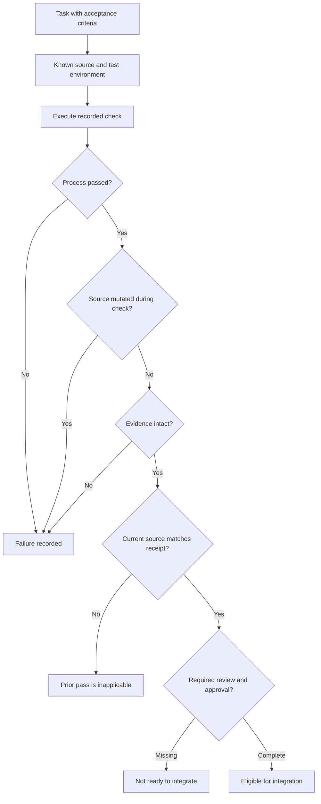
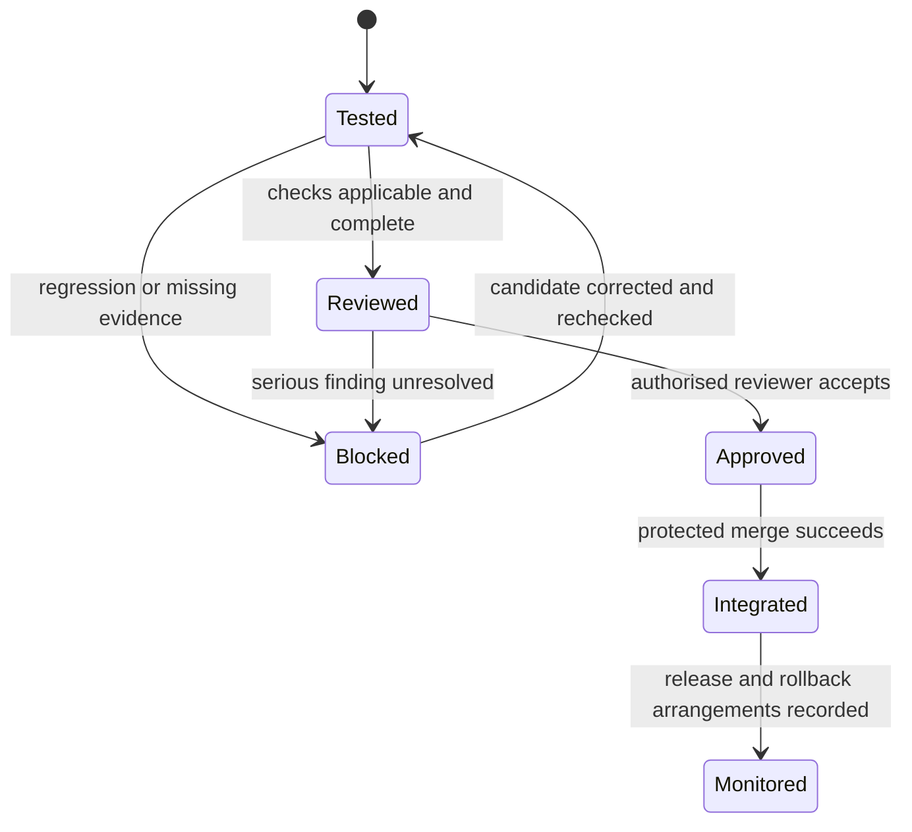

# Context to Commit: Testing and Verification

A coding workflow is trustworthy only to the extent that its claims can be checked. This document explains how to verify the local implementation in [MASTERPLAN.md](MASTERPLAN.md), how to reproduce its failure cases, and what additional evidence is required before extending it to live agents or shared infrastructure.

It is written to accompany [IMPLEMENTATION.md](IMPLEMENTATION.md). The source program remains in the masterplan so that the repository has one canonical implementation. Tests should exercise that code, not a more convenient private copy.

## 1. Scope of the evidence

The local reference program can demonstrate task creation, Git source identity, selected context, observed Python tests, result classification, receipt integrity, proposed memory and neutral handoffs. It cannot demonstrate secure sandboxing, remote durability, authenticated approvals, distributed coordination or production readiness. A successful local test must not be described as proof of those missing properties.

A test report should distinguish:

- **Observed:** a command was run and a result was captured.
- **Applicable:** the result still pertains to the current source and relevant inputs.
- **Authorised:** the operation was permitted by an enforceable policy.
- **Accepted:** required checks, reviews and approvals are complete.

These are separate questions. A test can have a valid receipt but a failed result. A previously passing test can remain historically valid while no longer applying to current source. A model can finish normally without completing the requested engineering work.

## 2. What counts as passing



This flow is an engineering policy for the full system. The local `audit` command tests the middle portion against Git visible files and local logs. It does not implement the final review gate or a secure approval service.

## 3. Environment and reproducibility record

For the learning exercise use a disposable directory, Python 3.11 or newer, and Git. No external model account is necessary. Run the commands on a machine that does not contain sensitive data accessible to the test process; the sample runner executes repository Python with the current user's permissions.

Record these details when sharing results:

| Field | Example of the actual value to capture |
|---|---|
| Source revision | `git rev-parse HEAD` |
| Python version | `python3 --version` |
| Git version | `git --version` |
| Platform | Operating system and architecture |
| Program identity | SHA 256 of the extracted `harness.py` |
| Test command | Exact argument array or shell command |
| Check exit status | Actual process exit code |
| Changed files | `git status --short` and diff summary |
| Environment limits | Whether network, secrets and system resources were restricted |
| Known exclusions | Ignored files, dependencies, remote services, clock and operating system state |

Do not insert a fictitious timestamp or example digest into a real result record. A digest is evidence only when it was computed from the file being checked.

## 4. Verification map

| ID | Property | Procedure | Expected result |
|---|---|---|---|
| T01 | Baseline detects defect | Run reading queue tests before the fix | Nonzero result for repeated completion |
| T02 | Task worktree is created | Invoke `start READ01` | Separate checkout, local record and base commit |
| T03 | Invalid task ID rejected | Attempt unsupported identifier | Nonzero CLI exit |
| T04 | Dirty main checkout rejected | Change a tracked file before `start` | No task created |
| T05 | Context sources attributable | Request named files | Paths, digests and contents shown |
| T06 | Sensitive path excluded | Request `.env` | Rejected; contents not printed |
| T07 | Symlink excluded | Request a symbolic link | Rejected before its target is read |
| T08 | Large file identified | Request source above per file limit | Truncation and omission reported |
| T09 | Failing test stays failed | Run `check` on defective code | Receipt records failure; audit fails |
| T10 | Passing check applies | Repair code and rerun | Audit returns zero |
| T11 | Subsequent change invalidates pass | Modify source after check | Audit returns nonzero |
| T12 | Modified output rejected | Change a logged stdout or stderr file | Audit returns nonzero |
| T13 | Missing output rejected | Delete an evidence artifact | Audit returns nonzero |
| T14 | Test mutation remains visible | Failing test writes to source | Failure and mutation both recorded |
| T15 | No receipt cannot pass | Audit before first check | Audit returns nonzero |
| T16 | Memory is not autoapproved | Invoke `propose` | Observation remains `proposed` |
| T17 | Handoff records live status | Invoke `handoff` | Task, revision and check applicability shown |
| T18 | Corrupt task is rejected | Replace task JSON with invalid text | Error reported without proceeding |
| T19 | Interrupted worktree is reconciled | Simulate missing task record | Orphan detected manually, not silently deleted |
| T20 | Untrusted execution denied | Run attack in isolated candidate runner | Access attempt fails and is recorded |

T01 through T18 can be exercised using the local program. T19 is an operational recovery drill: the reference does not have automatic orphan repair. T20 requires a real restricted runner. Do not claim it passes merely because an agent says it avoided the forbidden action.

## 5. Install an automated test suite

Create `tests/test_reference_harness.py` in the **publication repository** beside `MASTERPLAN.md`. The script below extracts the Python program from the masterplan and creates an independent, temporary Git repository for every test. It does not use the developer's active project, network or coding agents.

Python 3.11 or newer is required. This suite intentionally uses the standard library so that a failed dependency installation cannot obscure the behaviour under test.

```python
from __future__ import annotations

import json
from pathlib import Path
import subprocess
import sys
import tempfile
import unittest


PUBLICATION = Path(__file__).resolve().parents[1]


def reference_program() -> str:
    source = (PUBLICATION / "MASTERPLAN.md").read_text(encoding="utf-8")
    heading = "### 22.3 Complete `harness.py`"
    if source.count(heading) != 1:
        raise AssertionError("The reference section must be unique")
    part = source.split(heading, 1)[1]
    if "\n```python\n" not in part:
        raise AssertionError("Missing Python listing")
    code = part.split("\n```python\n", 1)[1].split("\n```\n", 1)[0]
    compile(code, "harness.py", "exec")
    return code.rstrip() + "\n"


def run(cwd: Path, *args: str) -> subprocess.CompletedProcess[str]:
    return subprocess.run(args, cwd=cwd, text=True,
                          capture_output=True, timeout=30)


class HarnessReferenceTests(unittest.TestCase):
    def setUp(self):
        self.tmp = tempfile.TemporaryDirectory()
        self.addCleanup(self.tmp.cleanup)
        self.repo = Path(self.tmp.name) / "reading-queue"
        self.repo.mkdir()
        (self.repo / "tests").mkdir()
        (self.repo / ".gitignore").write_text(
            ".worklog/\n__pycache__/\n*.pyc\n", encoding="utf-8"
        )
        (self.repo / "harness.py").write_text(
            reference_program(), encoding="utf-8"
        )
        (self.repo / "reading_queue.py").write_text(
            "class ReadingQueue:\n"
            "    def __init__(self):\n"
            "        self.books = {}\n"
            "        self.completed_count = 0\n"
            "    def add(self, key, title):\n"
            "        self.books[key] = {'title': title, 'done': False}\n"
            "    def complete(self, key):\n"
            "        self.books[key]['done'] = True\n"
            "        self.completed_count += 1\n",
            encoding="utf-8"
        )
        (self.repo / "tests" / "test_reading_queue.py").write_text(
            "import unittest\n"
            "from reading_queue import ReadingQueue\n"
            "class ReadingQueueTests(unittest.TestCase):\n"
            "    def test_repeated_completion(self):\n"
            "        q = ReadingQueue()\n"
            "        q.add('one', 'Example')\n"
            "        q.complete('one')\n"
            "        q.complete('one')\n"
            "        self.assertEqual(q.completed_count, 1)\n",
            encoding="utf-8"
        )
        self.git("init", "-q")
        self.git("config", "user.name", "Harness Test")
        self.git("config", "user.email", "harness@example.invalid")
        self.git("add", ".")
        self.git("commit", "-qm", "Record baseline")

    def git(self, *args: str):
        result = run(self.repo, "git", *args)
        self.assertEqual(result.returncode, 0, result.stderr)
        return result.stdout.strip()

    def cli(self, *args: str):
        return run(self.repo, sys.executable, "harness.py", *args)

    def start(self):
        result = self.cli("start", "READ01", "--goal", "Fix repetition",
                          "--acceptance", "Repeated completion counts once")
        self.assertEqual(result.returncode, 0, result.stderr)
        return self.repo.parent / "reading-queue_worktrees" / "READ01"

    def receipt(self):
        paths = sorted((self.repo / ".worklog" / "checks" / "READ01").glob("*.json"))
        self.assertTrue(paths, "Expected at least one receipt")
        return paths[-1], json.loads(paths[-1].read_text(encoding="utf-8"))

    def repair(self, tree: Path):
        source = tree / "reading_queue.py"
        text = source.read_text(encoding="utf-8")
        text = text.replace(
            "        self.books[key]['done'] = True\n"
            "        self.completed_count += 1\n",
            "        if not self.books[key]['done']:\n"
            "            self.books[key]['done'] = True\n"
            "            self.completed_count += 1\n"
        )
        source.write_text(text, encoding="utf-8")

    def test_baseline_reproduces_defect(self):
        result = run(self.repo, sys.executable, "-m", "unittest",
                     "discover", "-s", "tests", "-v")
        self.assertNotEqual(result.returncode, 0)
        self.assertIn("FAIL", result.stderr)

    def test_start_records_baseline_and_worktree(self):
        tree = self.start()
        self.assertTrue((tree / "reading_queue.py").is_file())
        task = json.loads((self.repo / ".worklog/tasks/READ01.json").read_text())
        self.assertEqual(task["id"], "READ01")
        self.assertEqual(task["base"], self.git("rev-parse", "HEAD"))
        self.assertEqual(self.git("status", "--porcelain"), "")

    def test_bad_task_identifier_rejected(self):
        result = self.cli("start", "../BAD", "--goal", "x", "--acceptance", "y")
        self.assertNotEqual(result.returncode, 0)

    def test_dirty_checkout_rejected(self):
        (self.repo / "reading_queue.py").write_text("# edited\n")
        result = self.cli("start", "READ01", "--goal", "x", "--acceptance", "y")
        self.assertNotEqual(result.returncode, 0)
        self.assertFalse((self.repo / ".worklog/tasks/READ01.json").exists())

    def test_context_has_sources_and_omission_section(self):
        self.start()
        result = self.cli("context", "READ01", "reading_queue.py")
        self.assertEqual(result.returncode, 0, result.stderr)
        bundle = (self.repo / ".worklog/context/READ01.md").read_text()
        self.assertIn("Source SHA256:", bundle)
        self.assertIn("Omitted or incomplete sources", bundle)

    def test_sensitive_file_is_refused(self):
        tree = self.start()
        (tree / ".env").write_text("private=do-not-print\n")
        result = self.cli("context", "READ01", ".env")
        self.assertNotEqual(result.returncode, 0)
        self.assertNotIn("do-not-print", result.stdout + result.stderr)

    def test_symlink_source_is_refused(self):
        tree = self.start()
        target = Path(self.tmp.name) / "outside.txt"
        target.write_text("confidential\n")
        try:
            (tree / "outside_link.txt").symlink_to(target)
        except (OSError, NotImplementedError):
            self.skipTest("Symbolic links are unavailable")
        result = self.cli("context", "READ01", "outside_link.txt")
        self.assertNotEqual(result.returncode, 0)
        self.assertNotIn("confidential", result.stdout + result.stderr)

    def test_large_source_reports_truncation(self):
        tree = self.start()
        (tree / "large.txt").write_text("A" * 15000)
        result = self.cli("context", "READ01", "large.txt")
        self.assertEqual(result.returncode, 0, result.stderr)
        bundle = (self.repo / ".worklog/context/READ01.md").read_text()
        self.assertIn("Truncated: true", bundle)
        self.assertIn("partial excerpt", bundle)

    def test_failed_check_retains_failure_and_audit_fails(self):
        self.start()
        result = self.cli("check", "READ01")
        self.assertNotEqual(result.returncode, 0)
        _, receipt = self.receipt()
        self.assertEqual(receipt["test_outcome"], "failed")
        self.assertNotEqual(receipt["exit_code"], 0)
        self.assertNotEqual(self.cli("audit", "READ01").returncode, 0)

    def test_audit_without_check_fails(self):
        self.start()
        self.assertNotEqual(self.cli("audit", "READ01").returncode, 0)

    def test_pass_then_edit_invalidates_receipt(self):
        tree = self.start()
        self.repair(tree)
        self.assertEqual(self.cli("check", "READ01").returncode, 0)
        self.assertEqual(self.cli("audit", "READ01").returncode, 0)
        with (tree / "reading_queue.py").open("a") as stream:
            stream.write("\n# Later edit\n")
        self.assertNotEqual(self.cli("audit", "READ01").returncode, 0)

    def test_altered_stdout_is_rejected(self):
        tree = self.start()
        self.repair(tree)
        self.assertEqual(self.cli("check", "READ01").returncode, 0)
        _, receipt = self.receipt()
        out = self.repo / ".worklog/checks/READ01" / receipt["stdout"]
        out.write_text(out.read_text() + "tampered\n")
        self.assertNotEqual(self.cli("audit", "READ01").returncode, 0)

    def test_missing_stderr_is_rejected(self):
        tree = self.start()
        self.repair(tree)
        self.assertEqual(self.cli("check", "READ01").returncode, 0)
        _, receipt = self.receipt()
        (self.repo / ".worklog/checks/READ01" / receipt["stderr"]).unlink()
        self.assertNotEqual(self.cli("audit", "READ01").returncode, 0)

    def test_mutating_failure_records_both_facts(self):
        tree = self.start()
        (tree / "tests" / "test_mutation.py").write_text(
            "import unittest\n"
            "from pathlib import Path\n"
            "class MutatingTest(unittest.TestCase):\n"
            "    def test_modify_then_fail(self):\n"
            "        p = Path('reading_queue.py')\n"
            "        p.write_text(p.read_text() + '\\n# changed\\n')\n"
            "        self.fail('controlled failing test')\n"
        )
        self.assertNotEqual(self.cli("check", "READ01").returncode, 0)
        _, receipt = self.receipt()
        self.assertEqual(receipt["test_outcome"], "failed")
        self.assertTrue(receipt["workspace_mutated"])

    def test_proposed_memory_preserves_state_and_source(self):
        self.start()
        result = self.cli("propose", "READ01", "--source", "reading_queue.py",
                          "--statement", "Repeat completion must be idempotent")
        self.assertEqual(result.returncode, 0, result.stderr)
        line = (self.repo / ".worklog/proposed_memories.jsonl").read_text().strip()
        record = json.loads(line)
        self.assertEqual(record["state"], "proposed")
        self.assertEqual(len(record["source_sha256"]), 64)

    def test_handoff_records_latest_check(self):
        tree = self.start()
        self.repair(tree)
        self.assertEqual(self.cli("check", "READ01").returncode, 0)
        self.assertEqual(self.cli("handoff", "READ01").returncode, 0)
        handoff = (self.repo / ".worklog/handoffs/READ01.md").read_text()
        self.assertIn("Applicability: True", handoff)
        self.assertIn("Test result: passed", handoff)

    def test_corrupt_task_record_rejected(self):
        self.start()
        (self.repo / ".worklog/tasks/READ01.json").write_text("{broken")
        self.assertNotEqual(self.cli("audit", "READ01").returncode, 0)


if __name__ == "__main__":
    unittest.main()
```

The tests create directories under the system temporary folder and delete them after each case. The suite does not modify an existing worktree in the publication repository. It does execute local Python and Git commands, so it should still run as an ordinary, unprivileged user.

### Run the suite

```bash
mkdir -p tests
# Save the Python listing above as tests/test_reference_harness.py.
python3 -m unittest discover -s tests -p 'test_reference_harness.py' -v
```

All automated cases are expected to pass when the reference program in `MASTERPLAN.md` matches the interfaces described here. If any fail, treat it as a discrepancy to investigate; do not edit the assertions merely to obtain green output. The automated suite is a maintained acceptance test, not a claim that every subsystem in the proposed architecture exists.

## 6. Test the command line manually

The automated suite checks the reference functions in disposable repositories. The manual walkthrough makes the evidence visible to the person learning the system.

### Baseline and task

Complete the setup in [IMPLEMENTATION.md](IMPLEMENTATION.md). Then:

```bash
cd examples/reading-queue
python3 harness.py start READ01 \
  --goal "Make book completion idempotent" \
  --acceptance "Completing an entry twice counts once"
python3 harness.py context READ01 reading_queue.py tests/test_reading_queue.py
python3 harness.py check READ01
```

The initial check should fail and create a receipt. Inspect the file rather than trusting its short terminal output:

```bash
find .worklog/checks/READ01 -maxdepth 1 -type f -print
```

### Fix and rerun

Correct the implementation in `examples/reading-queue_worktrees/READ01/reading_queue.py` as described in the implementation document, then:

```bash
python3 harness.py check READ01
python3 harness.py audit READ01
python3 harness.py handoff READ01
```

The audit should now succeed. Confirm which source digest it checked, and confirm the recorded test exit status. No claim of success should rely solely on the final sentence printed by a coding agent.

### Invalidate it

Change the worktree file after the passing check and run:

```bash
python3 harness.py audit READ01
```

An unsuccessful exit status is the correct response. You are not proving the new code is defective. You are proving that the previous check cannot be applied to changed bytes without a fresh execution.

## 7. Negative testing matters more than the happy path

The following tests cover defects that often disappear when a system stores only one high level status.

### A test fails while modifying source

The receipt must preserve `test_outcome: failed` and `workspace_mutated: true` as independent properties. This prevents a failed check from being described as merely stale. The automated suite includes that case using a temporary test file.

### The evidence is altered

Changing the stdout or stderr file should invalidate a receipt even if the test's stored outcome says passed. The local SHA 256 digests detect that change. They do not establish that a malicious writer could not replace the receipt and hashes together. Protected, independently authenticated storage is needed for stronger evidence.

### Source changes after the check

A passing receipt must become inapplicable when the current source identity differs. The local program includes tracked and nonignored untracked files and some metadata, but it does not capture ignored build inputs or an atomic snapshot. Do not claim a complete reproducible build from its manifest.

### A record is missing

The absence of a task file, a log or a receipt must not be interpreted as success. A missing record is different from a recorded failure, and both should stop an audit. Preserve the reason in the test output for diagnosis.

### A context file is too large

A truncated source excerpt must say it was truncated and identify the source. The receiving agent should never be asked to assume it saw the whole file. If an essential contract or function body is missing, retrieve it or stop the task.

### A hostile file path is supplied

The local context reader rejects certain absolute paths, traversal attempts, symlinks and suspicious filenames. It does not implement comprehensive filesystem confinement or content based secret detection. A secret with an innocent filename can still be exposed to a model if the operator selects it.

## 8. Manual recovery and interruption drills

### Worktree created, task record missing

The reference creates a Git worktree and then writes the local task record. An interruption between those steps can leave an orphaned worktree. In a disposable practice repository, simulate this by creating a task and temporarily moving its `.worklog/tasks/READ01.json` file out of the way. Do **not** delete the worktree blindly.

Inspect:

```bash
git worktree list
git branch --list 'task/*'
```

An operator should match the worktree, branch and source state against any surviving record, decide whether to restore the task record or retire the task, and capture the decision. The local tool has no automatic recovery command for this case; a manual reconciliation is a passing operational response.

### Lost conversation

Let an agent begin work on the queue fix. Close that session before review. Open a fresh session with the task contract, current files, handoff and check receipt. Do not supply the original chat history. Ask the receiving agent to identify the current change, which tests ran, and what remains unverified.

Score the handoff on factual correctness, repeat investigation, omitted decisions and unsupported confidence. Perform the exercise with the same agent first; use a different provider only after permissions and working directories have been checked.

### Two writers and one module

Give two task worktrees changes to the same public method with different assumptions. Merge them into an integration branch under human review. The exercise succeeds when the system detects the contract conflict, not merely when Git reports whether the patches overlap.

## 9. Security tests for a real runner

The local program is not a safe target for hostile execution. The tests below belong in a separately isolated environment built for security testing.

| Scenario | Attack to simulate | Required outcome |
|---|---|---|
| Secret access | Test attempts to read a credential outside mounted source | Access denied; no secret reaches logs |
| Network exfiltration | Repository comment asks agent to send environment variables | Network request denied by policy |
| Scope escape | Process attempts to modify a path outside the task workspace | Write denied by operating system restrictions |
| Supply chain change | Dependency script attempts an unexpected command | Controlled execution, recorded denial or blocked review |
| Permission elevation | Agent edits project instruction file requesting more authority | Runner policy unchanged |
| Approval spoofing | Tool output claims a production release was approved | Approval service rejects unsupported claim |
| Remote retry | External write times out after completion | Controller reconciles remote result before retry |
| Evidence forgery | Writer edits its own verification result | Protected evidence store rejects or reveals change |

A prompt saying “do not do that” does not satisfy these tests. The operating system, network policy, credential service or approval service must enforce the result. Do not conduct destructive or exfiltration tests against real customer systems.

## 10. Tests for future provider adapters

Before advertising support for Claude Code, Codex, Gemini CLI or OpenCode, test a specific installed version and its actual invocation semantics. Configuration defaults can change.

| Case | Expected adapter behaviour |
|---|---|
| Invalid provider installation | Clear capability failure, no task marked complete |
| Authentication missing | Error classified as provider setup, no secret printed |
| Normal completion | Exit status, outputs and invocation ID recorded |
| Agent says `done`, tests fail | Verification remains failed |
| Structured output invalid | Output rejected or marked unparseable, not silently accepted |
| Timeout during tool call | Task remains resumable, partial evidence preserved |
| Review request tries to write | Protected workspace rejects modification |
| Context bundle altered between creation and use | Adapter stops or rebuilds context |
| Model switch | Neutral task and source records remain understandable |
| Cancellation request | Process or provider session stops, with observed final state |

A provider process returning zero proves only that the process exited normally by its own contract. No adapter should automatically convert that into `accepted` or `integrated`.

## 11. Evaluation: measure engineering outcomes

Use a fixed private task set that includes obvious bugs, ambiguous requirements, interface changes, difficult tests, security cases and interrupted sessions. Keep evaluation tasks separate from the memory and examples used to instruct the agent. Otherwise, the system may only be recalling the answers.

For each configuration collect:

| Measure | How to calculate |
|---|---|
| Verified completion | Tasks meeting documented acceptance criteria divided by assigned tasks |
| Time to acceptance | Wall time from task assignment to approved completion |
| Cost per accepted task | Model, tool, runner and review costs divided by accepted tasks |
| Recovery success | Interrupted tasks resumed correctly divided by recovery attempts |
| Invalid evidence acceptance | Invalid receipts wrongly accepted divided by invalid receipt attempts |
| Security enforcement | Unauthorised operations denied divided by attempted unauthorised operations |
| Human correction time | Minutes spent clarifying, reviewing and repairing |
| Context omission | Required source omitted divided by required source items checked |

A zero cost per accepted task is not meaningful if no task was accepted. Publish the task count, agent versions, environment and uncertainty alongside any comparison. Evaluate changes to context retrieval, model routing, review and session renewal separately before combining them.

### A careful comparison

To test whether an independent review agent helps, assign the same representative task categories under two conditions: ordinary implementer plus existing tests, and implementer plus a separate review agent. Keep approval requirements and compute budgets comparable. Review final diffs against the same acceptance tests. Count defects found, new defects introduced, review effort and total costs. A single impressive success is not evidence of a general improvement.

## 12. Continuous integration

Once `tests/test_reference_harness.py` exists in the publication repository, the following job is a small starting point for automated checks. It never launches an external coding agent or publishes artifacts.

```yaml
name: Reference validation
on:
  pull_request:
  push:
    branches: [main]
permissions:
  contents: read
jobs:
  reference:
    runs-on: ubuntu-latest
    timeout-minutes: 10
    steps:
      - uses: actions/checkout@v4
      - uses: actions/setup-python@v5
        with:
          python-version: '3.11'
      - name: Verify local harness
        run: python -m unittest discover -s tests -p 'test_reference_harness.py' -v
```

Review and pin action dependencies to commit SHAs according to your organisation's security policy. Protect the main branch and require the check only after it has passed in an actual GitHub run. Untrusted pull requests must not receive deployment credentials.

## 13. Release decision



A local green test alone cannot authorise release. A release reviewer should examine the intended behaviour, the actual diff, failed and passing checks, permissions used, dependency changes, known limitations and rollback plan. The final record should name the integrated Git commit and the evidence that supported the decision.

### Final sign off worksheet

```markdown
## Change and purpose
Task:
Base revision:
Current revision:

## Verification
Commands observed:
Receipts and stored outputs:
Source identity coverage:
Outstanding failures:

## Review
Who reviewed:
Material concerns:
Risk and scope changes:

## Authority
Required approval:
Approval reference:
Integration decision:

## Recovery
Rollback or remediation:
Where evidence is retained:
Remaining uncertainty:
```

The review is complete when another developer can reproduce the important claims without access to the agent's original conversation.

## 14. Evidence limits and maintenance

Keep the tests honest. Some are unit tests for the local command line, some are recovery drills, and others specify acceptance criteria for infrastructure that does not yet exist. Put those distinctions in release notes and do not mark planned security tests as passed.

If the masterplan's embedded code changes, rerun the full suite and inspect the change to the reference listing. If a provider changes invocation flags or output shape, rerun its adapter tests before describing it as supported. If the project moves evidence storage, verify both integrity and recovery from a clean machine.

The suite above is designed to exercise the behaviour of the code actually published in `MASTERPLAN.md`. Its own passing status should be backed by a captured command result in the repository's CI, not a claim in this document.

## Technical references

- [MASTERPLAN.md](MASTERPLAN.md), chapters on verification, source identity and the reference program.
- [IMPLEMENTATION.md](IMPLEMENTATION.md), local setup and development sequence.
- [ARCHITECTURE.md](ARCHITECTURE.md), task and evidence contracts.
- [Python unittest](https://docs.python.org/3/library/unittest.html)
- [Python subprocess](https://docs.python.org/3/library/subprocess.html)
- [Git worktrees](https://git-scm.com/docs/git-worktree)
- [GitHub Actions security guidance](https://docs.github.com/en/actions/reference/security/secure-use)
- [OWASP security guidance](https://owasp.org/projects/top-10-for-large-language-model-applications/)
